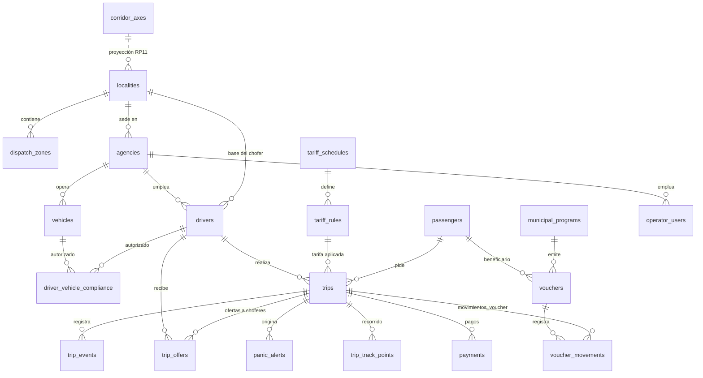

# Modelo de datos

PostgreSQL 16 + PostGIS 3.4. Todas las geometrías son SRID 4326; los cálculos en metros sobre el corredor se hacen en UTM 21S (`lc_metric_srid()` = 32721). Actualizado el **2026-11-22** (migraciones `20261120120000` a `20261122100000`). Fase 3: autenticación, pagos, vouchers y COM (rehecha el 2026-11-22). Fase 5: documentos de habilitación y auditoría.

El estado en tiempo real (posiciones, colas de parada, ofertas y locks) vive en Redis: ver la
[documentación de la Fase 2](bitacora/2026-11-20-fase-2-redis-gps-despacho/DOCUMENTACION.md).

## Tablas

| Tabla | Qué guarda | Claves e índices destacados |
|---|---|---|
| `corridor_axes` | Eje de la RP11 (norte → sur) para referenciación lineal | `GIST(geom)` |
| `localities` | 14 localidades con polígono y orden sobre el corredor | `GIST(geom)`, `corridor_order` único, trigger anti-superposición |
| `dispatch_zones` | Zonas/paradas de alta demanda dentro de una localidad | `GIST(geom)`, `GIST(pickup_point)`, trigger "dentro de su localidad" |
| `agencies` | Agencias de remises habilitadas | CUIT validado, `GIST(base_location)`; `mp_collector_id` (cuenta colectora Mercado Pago, Fase 3); `verified_by`/`verified_at` (Fase 5) |
| `drivers` | Choferes: licencia profesional, habilitación municipal, estado, `accepts_interurban`, PIN de autenticación | DNI/CUIL únicos, CUIL coincide con DNI; `pin_hash`, `pin_failed_attempts`, `pin_locked_until` (Fase 3); `verified_by`/`verified_at` (Fase 5) |
| `vehicles` | Vehículos: VTV, seguro de pasajeros, habilitación | Patente Mercosur o anterior; remis exige agencia; `verified_by`/`verified_at` (Fase 5) |
| `driver_vehicle_compliance` | Autorización chofer↔vehículo con vigencia | `EXCLUDE` sin vigencias superpuestas por par |
| `tariff_schedules` | Cuadro tarifario aprobado: vigencia, franja nocturna, umbral, redondeo | `EXCLUDE` sin cuadros aprobados superpuestos |
| `tariff_rules` | Valores por servicio × alcance × temporada × franja | Único por combinación y cuadro |
| `season_periods` | Calendario de temporada alta | `GIST(period)` |
| `passengers` | Registrados e invitados (QR, solo hash de sesión) | `guest_session_hash` único |
| `trips` | Viajes con tarifa cotizada, desglose, estado y progreso de búsqueda (`dispatch_round`, `dispatch_started_at`) | `GIST` en origen/destino, `BRIN(requested_at)`, un viaje activo por chofer y por vehículo; Fase 3: `metered_fare_cents`, `final_breakdown`, `passenger_rating`, `cancellation_fee_cents` |
| `trip_offers` | Cada oferta de un viaje a un chofer: ronda, rango, puntaje y desglose, ETA, Viaje de Vuelta, resultado | Una sola oferta `PENDING` por viaje (índice único parcial) |
| `trip_track_points` | Recorrido GPS del viaje desde la asignación | PK `(trip_id, recorded_at)` idempotente, `GIST(geom)`, `BRIN(recorded_at)` |
| `operator_users` | Operadores COM, agencia y municipio (usuario + contraseña) | `username` único; rol `COM_OPERATOR`/`AGENCY_OPERATOR`/`MUNICIPAL_ADMIN`; bloqueo por intentos |
| `auth_refresh_tokens` | Refresh tokens rotativos (solo hash) | `token_hash` único; `family` para detectar reutilización; vencimiento y revocación |
| `otp_challenges` | Desafíos OTP para pasajeros registrados | teléfono, hash del código, intentos, vencimiento |
| `idempotency_keys` | Idempotencia HTTP (crear viaje, pánico, pagos) | UNIQUE `(actor_kind, actor_id, key)`; respuesta guardada 24 h |
| `payments` | Detalle de cobros por viaje. El monto sale siempre del viaje, nunca del cliente | UNIQUE `provider_reference` (id del pago de MP, webhook idempotente) y `provider_preference_id` (link/QR); un solo cobro efectivo/voucher `PAID` por viaje; un solo cobro de MP `PENDING` por viaje |
| `municipal_programs` | Programas de vouchers con presupuesto por período | `spent_cents <= budget_cents` |
| `vouchers` | Vouchers con saldo y vigencia | `code` único; `beneficiary_dni_hash` (Ley 25.326) |
| `voucher_movements` | Reserva, consumo y liberación de saldo de voucher | monto > 0; `balance_after_cents >= 0` |
| `trip_events` | Bitácora de eventos del viaje. Su `id` es el `seq` que reciben las apps para recuperar lo perdido al reconectar | `client_event_id` único (reintentos), índice `(trip_id, id)`, `GIST(location)` |
| `panic_alerts` | Alertas de pánico al COM con snapshot | `client_event_id` único, `GIST(location)`, `pg_notify`; Fase 3: `escalated_at`, `escalation_count` |
| `habilitation_documents` | Documentos que respaldan una habilitación (DNI, licencia, VTV, seguro, etc.) — solo hash del archivo | Por entidad (chofer/vehículo/agencia); `verified_by`/`verified_at` |
| `audit_log` | Auditoría de cambios sobre entidades del sistema | actor, action, entity, changes (jsonb), occurred_at |

## Vistas y funciones

| Objeto | Para qué |
|---|---|
| `v_driver_vehicle_eligibility` | `blocking_reasons`, `is_eligible` y `next_expiry_on` por par chofer↔vehículo, calculados contra `ar_today()` |
| `v_locality_corridor_ranges` | Rango `[from_m, to_m]` de cada localidad sobre la RP11 |
| `resolve_locality(lon, lat, max_m)` | Localidad de un punto: `CONTAINED` o `NEAREST_FALLBACK` |
| `corridor_stretch(origen, destino, localidad, ruta)` | Progresivas y metros fuera de la localidad de origen |
| `corridor_position_m(punto)` | Progresiva de un punto sobre la RP11 |
| `route_outside_locality_m(ruta, localidad)` | Metros de una ruta fuera de una localidad (`ST_Difference`) |
| `season_for(fecha)` | Temporada de una fecha local |
| `is_valid_cuit(text)`, `ar_today()` | Validación de CUIT/CUIL y fecha de hoy en hora argentina |
| `v_payment_summary` | Vista: resumen de pagos por viaje (pagado, último estado, método) |
| `v_com_open_alerts` | Vista: alertas de pánico abiertas para el COM con datos de viaje/chofer/viaje |
| `voucher_available_balance(uuid)` | Saldo disponible de un voucher |
| `voucher_can_cover(uuid, integer)` | Si un voucher puede cubrir un monto (saldo, activo, vigente) |
| `trip_paid_cents(uuid)` | Total pagado (PAID) de un viaje |
| `cleanup_expired_idempotency_keys()` | Limpieza de claves de idempotencia vencidas |
| `cleanup_expired_otp_challenges()` | Limpieza de desafíos OTP vencidos |
| `cleanup_expired_refresh_tokens()` | Limpieza de refresh tokens vencidos |
| `voucher_trip_hold_cents(trip)` | Saldo de voucher reservado y pendiente para un viaje (reservas − liberaciones − consumos) |
| `municipal_program_held_cents(programa)` | Saldo comprometido de un programa (se suma a `spent_cents` para no pasar el presupuesto) |
