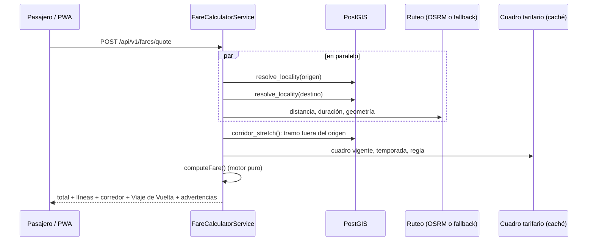
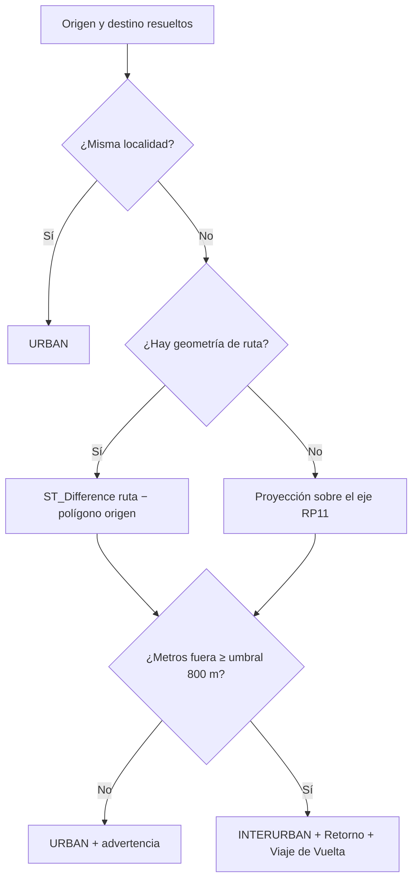
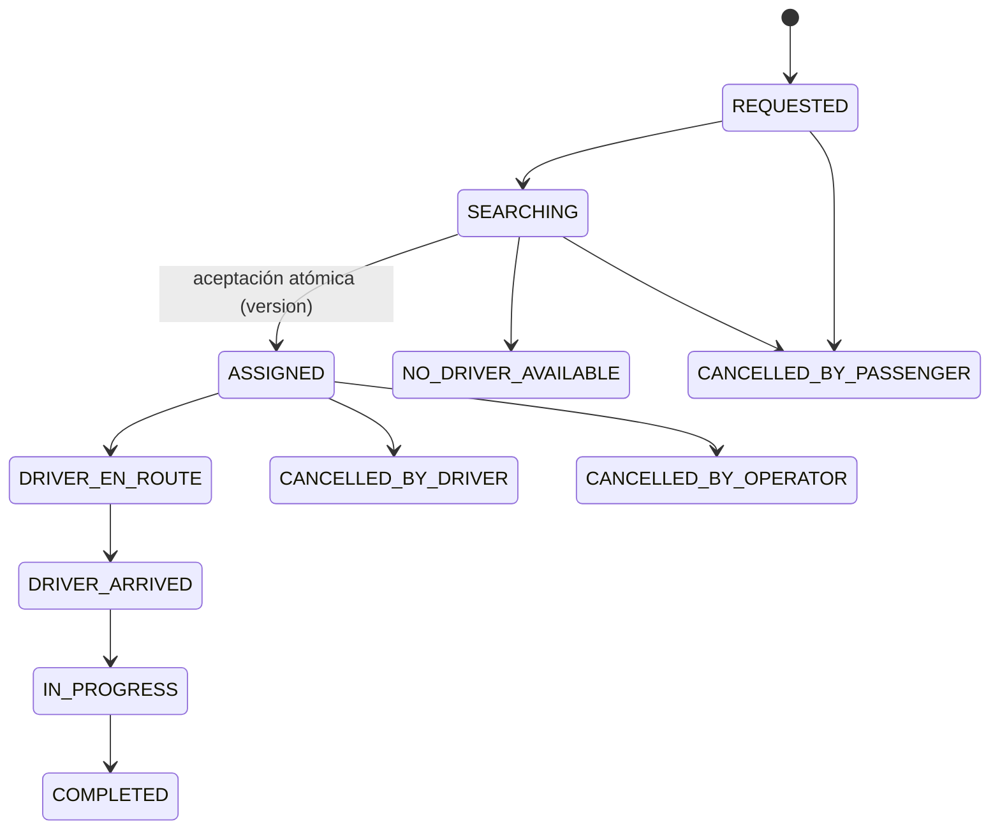

# Fase 1 · Monorepo, esquema PostGIS y motor tarifario: documentación

## Qué hace

Deja armada la base del sistema: el monorepo, el modelo de datos en PostgreSQL + PostGIS y el cálculo de la tarifa regulada.

Con un origen, un destino y el tipo de servicio (taxi o remis), la API devuelve una **tarifa cerrada y desglosada línea por línea**. Ubica cada punto en su localidad, mide cuánto del recorrido cae fuera de la localidad de origen sobre la RP11 y aplica la regla del cuadro vigente según franja y temporada. También indica si el chofer queda candidato a un **Viaje de Vuelta**.

La base protege por sí misma las reglas críticas: rechaza asignar choferes o vehículos no habilitados y que un chofer tenga dos viajes activos.



## Motor tarifario puro

`computeFare()` (`packages/domain`) no hace I/O ni lee el reloj: es determinístico. Lo usa el backend y en la Fase 4 lo va a reutilizar la app del chofer como **taxímetro digital sin conexión**, con el cuadro cacheado.

```
total = bandera
      + ceil(distancia / metros_por_ficha) × ficha
      + floor(espera / segundos_por_ficha) × ficha
            espera = max(0, duración − distancia / velocidad_referencia) + espera_solicitada
      + Retorno Interurbano = coef × ceil(metros_fuera_del_origen / metros_por_ficha) × ficha
      − bonificación Viaje de Vuelta (el chofer asignado termina en su localidad base)
      → ajuste a mínima → redondeo half-up al paso del cuadro ($10)
```

- Los importes son centavos enteros y los porcentajes, puntos básicos (4000 = 40 %). No hay floats en el dinero.
- La suma de las líneas es siempre igual al total. El código lo verifica y lo prueba con 500 casos aleatorios.

## Alcance urbano o interurbano



- **Referenciación lineal:** cada punto se proyecta sobre el eje de la RP11 (`ST_LineLocatePoint` en UTM 21S). La progresiva en metros crece de norte a sur y da el sentido del viaje, los límites cruzados y una medida de respaldo del tramo interurbano.
- **Umbral:** cruzar a Costa Azul por dos cuadras no cobra retorno. El umbral está en `tariff_schedules.interurban_min_outside_m`.
- **Medición degradada:** sin geometría de ruta, la proyección sobre el eje subestima levemente; el error favorece al pasajero.

## Franja, temporada y cuadro tarifario

- `tariff_schedules` guarda el cuadro aprobado: acto administrativo, vigencia sin solapamientos, franja nocturna (22:00–06:00 en el seed), umbral, redondeo y validez de la cotización.
- `tariff_rules` tiene valores explícitos por servicio × alcance × temporada × franja (16 filas en el seed).
- `season_periods` es el calendario de temporada alta. Si HIGH y LOW se superponen, gana HIGH; sin período la temporada es LOW.
- Todo se evalúa en `America/Argentina/Buenos_Aires` sobre `pricing_instant`. Una re-cotización por cambio de destino a mitad de viaje usa el inicio del viaje, para que no cambie la franja.

## Viaje de Vuelta (backhaul)

Toda cotización interurbana devuelve `backhaul.eligible = true`, junto con dónde queda libre el chofer, a qué localidad vuelve y en qué sentido. El despacho de la Fase 2 va a usarlo para ofrecerle primero pedidos en ese sentido.

Si el chofer asignado tiene su base en la localidad de destino, se recotiza con `assignedDriverBaseLocalityId` y el retorno se bonifica. Ese parámetro no se acepta por HTTP.

## Habilitaciones

`v_driver_vehicle_eligibility` calcula en el momento, contra `ar_today()`, los `blocking_reasons` de cada par chofer↔vehículo:

- VTV y seguro de pasajeros.
- Licencia profesional y habilitaciones municipales del chofer, del vehículo y de la agencia.
- Suspensiones.
- Pertenencia del chofer a la agencia del vehículo.

No se guarda un estado "vencido": la habilitación bloquea apenas vence, sin depender de un cron.

## Viaje



En la Fase 1 solo existe el modelo y las reglas de la base; las transiciones por API llegan en la Fase 3.

## Edge cases cubiertos

| Caso | Tratamiento |
|---|---|
| Punto justo sobre el límite entre dos localidades | `ST_Covers` + desempate por `corridor_order` (gana la del norte) |
| Tramo rural (San Clemente ↔ Las Toninas), playa o GPS impreciso | `NEAREST_FALLBACK` (KNN sobre `GIST` + distancia geodésica) hasta 6 km, con advertencia |
| Punto mar adentro o fuera del partido | 422 `OUT_OF_SERVICE_AREA` |
| Cruce mínimo de límite | Urbano, con advertencia `CROSSING_BELOW_INTERURBAN_THRESHOLD` |
| Cambio de destino o de localidad a mitad de viaje | Re-cotización con `pricingInstant` = inicio: la franja y la temporada se mantienen y el alcance se re-evalúa |
| OSRM caído o saturado | Fallback geodésico marcado `ROUTING_DEGRADED` y circuito abierto 30 s |
| Cortes breves de la base | Cuadro tarifario en caché con *stale-if-error* |
| Doble aceptación de un viaje | `UPDATE … WHERE status='SEARCHING' AND version=$v` + índice único parcial por chofer y por vehículo (en Fase 2 se suma el lock de Redis) |
| Habilitación vencida o suspendida | El trigger bloquea la asignación; un viaje en curso termina normalmente |
| Chofer de una agencia con el remis de otra | `CHOFER_NO_PERTENECE_A_LA_AGENCIA_DEL_VEHICULO` |
| Reintentos del botón de pánico con mala red | `client_event_id` único y `pg_notify('com_panic_alerts')` como respaldo al COM |
| Cliente que intenta forzar bonificaciones o franja | Parámetros internos rechazados con 400 (`forbidNonWhitelisted`) |

## Qué cambia para cada rol

Nada para los usuarios: todavía no hay apps ni panel. Por ahora la cotización solo se puede usar por API.

## Privacidad y datos personales

El esquema prevé guardar datos personales que todavía no se cargan desde ninguna interfaz. Quedan para revisar en el marco de la Ley 25.326 antes de producción:

- **Choferes:** DNI, CUIL y teléfono.
- **Pasajeros registrados:** teléfono.
- **Viajes y alertas de pánico:** ubicación GPS.

El Modo Invitado guarda solo el hash del token de sesión. Los datos del seed son ficticios.

## Dónde está cada cosa

| Qué | Archivo / ubicación |
|---|---|
| Motor tarifario puro | `packages/domain/src/fare-engine.ts` |
| Franja, temporada y tipos del cuadro | `packages/domain/src/tariff.ts`, `time.ts` |
| Orquestación de la cotización | `apps/api/src/modules/fares/fare-calculator.service.ts` |
| Endpoint | `POST /api/v1/fares/quote` (`fares.controller.ts`) |
| Resolución espacial | `apps/api/src/modules/geo/postgis-locality-resolver.ts` y las funciones SQL `resolve_locality()`, `corridor_stretch()` |
| Ruteo (OSRM, fallback, circuit breaker) | `apps/api/src/modules/routing/` |
| Esquema | `packages/db/migrations/20261120120000_*` a `20261120120400_*` |
| Seeds de La Costa | `packages/db/seeds/20261120130000_*` a `20261120130200_*` |
| Modelo de datos resumido | [`docs/MODELO_DATOS.md`](../../MODELO_DATOS.md) |
