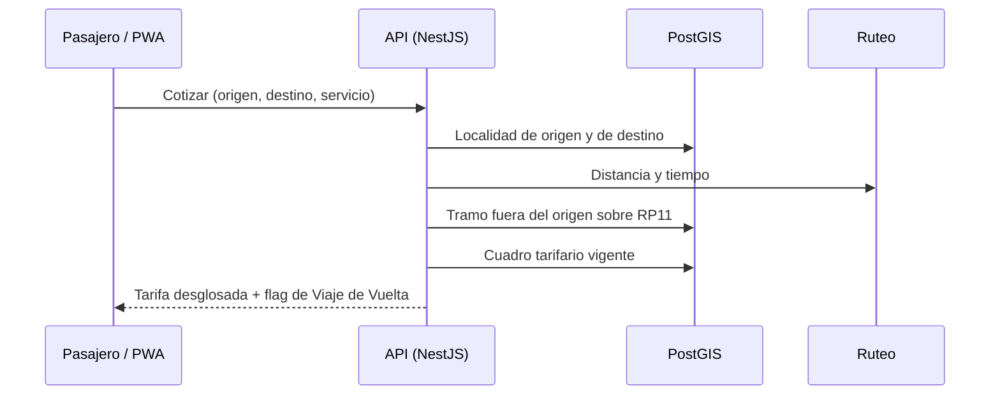

# Plan: Fase 1 · Monorepo, esquema PostGIS y motor tarifario

> Planeación original. Estado: **aprobada** (pedido del 2026-11-20).
> Nota: esta bitácora se adoptó después de implementar la fase, el mismo 2026-11-20. Este plan reconstruye lo que se pidió y se acordó antes de escribir el código; no se edita más. Las diferencias con lo construido están en la guía de implementación.

## Decisiones tomadas

| Tema | Decisión |
|---|---|
| Geografía | El partido es una franja de ~100 km sobre la RP11. Polígonos por localidad **más** referenciación lineal sobre el eje de la ruta; nada de radios circulares. |
| Detección de localidad | `ST_Contains` / `ST_Intersects` sobre polígonos, con fallback por distancia para los tramos rurales entre localidades. |
| Alcance de la tarifa | Urbana si origen y destino están en la misma localidad; interurbana por RP11 si cruza a otra. |
| Retorno Interurbano | Recargo transparente, calculado sobre lo recorrido fuera de la localidad de origen, más un flag de elegibilidad para la prioridad de Viaje de Vuelta. |
| Franja y temporada | Diurna/nocturna y baja/alta, configurables en el cuadro tarifario, evaluadas en hora argentina. |
| Habilitaciones | Solo operan vehículos y choferes con habilitación municipal, VTV, licencia profesional y seguro de pasajeros vigentes. Agencias de remises y choferes independientes. |
| Stack | NestJS + TypeScript, PostgreSQL + PostGIS (índices `GIST`), Redis (Fase 2), ruteo detrás de `IRoutingProvider` / `IMapProvider`, Expo y Next.js en fases posteriores. |
| Gestor de paquetes | pnpm con workspaces. |

## 1. El flujo completo

## 2. Estructura del monorepo

`apps/` (API, app del chofer, app del pasajero, PWA Modo Invitado, panel municipal) y `packages/` (tipos compartidos y base de datos). Las apps de las fases 4 y 5 solo se reservan.

## 3. Esquema de base de datos

Tablas `localities`, `dispatch_zones`, `agencies`, `drivers`, `vehicles`, `driver_vehicle_compliance`, `tariff_rules`, `trips` y `panic_alerts`, con índices `GIST`, constraints y seeds realistas de La Costa (San Bernardo, Mar de Ajó, Santa Teresita, San Clemente).

## 4. Motor tarifario

`FareCalculatorService` completo y tipado: detección espacial de localidades, urbana vs. interurbana, coeficiente de Retorno Interurbano, flag de Viaje de Vuelta, franja horaria y temporada.

## 5. Requisitos antes de empezar

- Node, pnpm y Docker (para PostGIS) en la máquina.
- Datos oficiales del municipio (polígonos y cuadro tarifario): no están disponibles; se usan valores aproximados marcados como tales.

## 6. Orden de implementación

1. Estructura del monorepo.
2. Esquema SQL y seeds.
3. Motor tarifario y `FareCalculatorService`.
4. Pruebas.
5. Documentar y proponer la Fase 2, y esperar confirmación.
