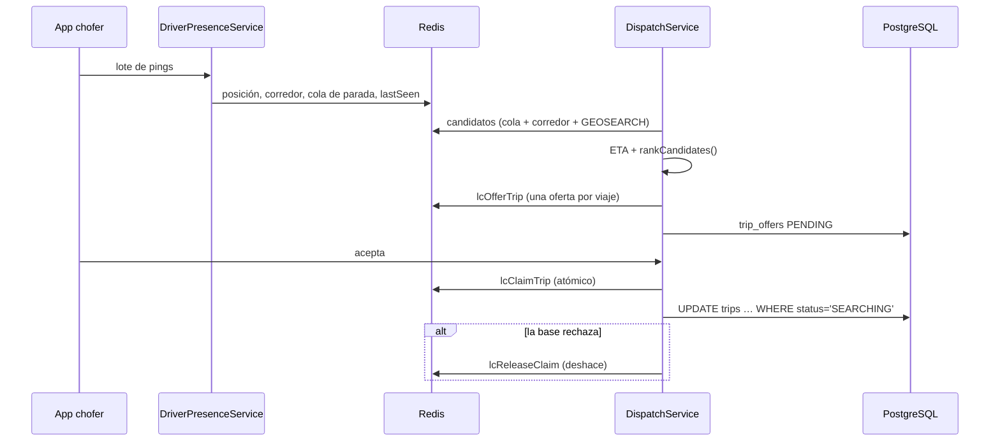
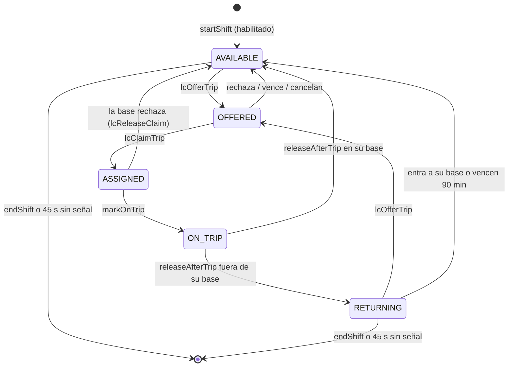

# Fase 2 · Redis GPS, colas de despacho y lock atómico: documentación

## Qué hace

Mantiene en Redis, en tiempo real, dónde está cada chofer en turno y en qué estado. Con eso decide a quién ofrecerle cada viaje, y lo asigna de forma que **nunca** haya dos choferes con el mismo viaje ni un chofer con dos viajes.

- **Al abrir el turno:** se exige que el par chofer↔vehículo esté habilitado.
- **Pings:** cada uno ubica al chofer en su localidad, en la parada (si está en una) y en su progresiva sobre la RP11. Esto se calcula en memoria, sin consultar PostGIS.
- **Candidatos:** cuando un viaje entra en búsqueda, se juntan los de la cola de la parada del origen, los de la ventana sobre el corredor y los de una búsqueda geográfica acotada. Se ordenan por tiempo de llegada, con bonificaciones y penalizaciones.
- **Ofertas:** se ofrece a uno por vez. Si acepta, un script Lua toma el viaje en Redis y PostgreSQL lo confirma.

## Estados del chofer

Un chofer `OFFERED`, `ASSIGNED` u `ON_TRIP` no puede cerrar el turno y el barrido no lo corta, aunque pierda la señal.

## Ingesta de posiciones

`DriverPresenceService.ingest(driverId, pings)` acepta lotes de hasta 500 pings, ordenados o no. La app los acumula mientras no hay señal y los manda juntos.

| Caso | Qué pasa |
|---|---|
| Ping más viejo que el último aplicado | No mueve al chofer; si está en viaje, igual se guarda en el recorrido |
| Precisión peor que 100 m | Cuenta como señal de vida, sin mover la posición |
| Salto imposible (más de `PRESENCE_MAX_SPEED_KMH`, 180 km/h) | Señal de vida; se suma a `suspiciousJumps` |
| Reloj del celular adelantado más de 2 min | Se usa la hora del servidor |
| Coordenadas inválidas | Se descarta el ping, no el lote |

La cola de la parada usa `ZADD NX`, así que los pings siguientes no le hacen perder el lugar al chofer. Si sale de la zona, deja la cola.

## Búsqueda y ranking

| Ronda | Ventana sobre RP11 | Radio `GEOSEARCH` | Tope de ofertas |
|---|---|---|---|
| 1 | ±4 km | 2,5 km | 5 |
| 2 | ±10 km | 6 km | 5 |
| 3 | ±25 km | 15 km | sin tope, hasta `DISPATCH_MAX_SEARCH_MS` (3 min) |

**Filtrado:**
- Servicio, estado `AVAILABLE` o `RETURNING`, y señal en los últimos 45 s.
- Preferencia interurbana (`drivers.accepts_interurban`).
- Habilitación vigente, revalidada contra la base cada 60 s.
- Se excluye a quien ya recibió una oferta de ese viaje.

**Lista corta:** los 8 más cercanos (el máximo entre la distancia sobre el corredor y la línea recta), más hasta 4 choferes en Viaje de Vuelta que coincidan con el viaje. A esa lista se le pide el tiempo de llegada al proveedor de ruteo.

**`rankCandidates()`** (`packages/domain`), en segundos equivalentes, gana el menor:

| Componente | Valor |
|---|---|
| ETA | segundos del ruteo |
| Rechazos y vencimientos en los últimos 30 min | +60 s cada uno (tope 5) |
| Viaje de Vuelta: termina en su base (`HOME`) | −600 s |
| Viaje de Vuelta: va en su sentido (`DIRECTION`) | −300 s |
| Cola de la parada del origen | −120 s el primero, 30 s menos por cada puesto |
| Tiempo esperando sin viaje | −2 s por minuto (tope 60 s) |

Desempate: ETA y después id del chofer, así el orden es determinístico. El desglose se guarda en `trip_offers.score_breakdown`.

## Ofertas, aceptación y garantías

Todo lo crítico corre en scripts Lua, que se ejecutan de forma atómica en Redis (`apps/api/src/redis/lua-scripts.ts`).

| Script | Garantía |
|---|---|
| `lcOfferTrip` | Una sola oferta abierta por viaje y por chofer; no ofrece viajes ya tomados |
| `lcClaimTrip` | Gana solo quien tiene la oferta vigente y no vencida. La misma aceptación repetida devuelve `ALREADY_YOURS` (idempotente) |
| `lcReleaseClaim` | Si PostgreSQL rechaza la asignación (trigger de habilitación, viaje cancelado), deshace el lock y devuelve al chofer a su estado anterior |
| `lcRespondOffer` | Rechazo, vencimiento o cancelación; solo actúa si la oferta sigue siendo esa |
| `lcPopExpiredOffers` | Cada vencimiento lo procesa una sola réplica |
| `lcAcquireLease` / `lcReleaseLease` | Una réplica por vez despacha cada viaje; si muere, otra lo retoma cuando vence el lease (10 s) |
| `lcOpenShift` / `lcCloseShift` | Un vehículo no puede estar en turno con dos choferes; no se cierra un turno con viaje u oferta |

En la base quedan las defensas de la Fase 1:
- El índice único de un viaje activo por chofer y por vehículo.
- El trigger de habilitación.
- `trip_offers_one_pending_per_trip`, que impide dos ofertas abiertas por viaje.

**Motivos de conflicto** que recibe la app del chofer (`DispatchConflictError.reason`): `OFFER_EXPIRED`, `ALREADY_TAKEN`, `TRIP_CANCELLED`, `TRIP_NOT_SEARCHING`, `CLAIM_FAILED`, `DRIVER_BUSY`, `VEHICLE_IN_USE` e `INVALID_STATE`.

## Viaje de Vuelta

Al terminar un viaje (`releaseAfterTrip`), si el chofer está fuera de su localidad base queda `RETURNING`. Se guardan su base y el sentido sobre la RP11 hacia ella, con vencimiento a los 90 min. Vuelve a `AVAILABLE` al entrar a su base o cuando vence ese plazo.

Si acepta un viaje que termina en su base (`HOME`):
- El viaje se recotiza con `assignedDriverBaseLocalityId` y se bonifica el Retorno Interurbano.
- Se guarda `is_backhaul_assignment = true`.
- La tarifa solo se actualiza si baja.

## Recorrido GPS

Desde la asignación, los pings van al Redis Stream `lc:gps:track`. Un consumidor por réplica los guarda por lotes en `trip_track_points`:
- La clave `(trip_id, recorded_at)` hace que los reintentos no dupliquen puntos.
- Si una réplica muere, otra reclama sus pendientes al minuto (`XAUTOCLAIM`).
- Si Redis pierde el grupo de consumidores (por ejemplo, un reinicio sin persistencia), se recrea solo.

## Si Redis se cae

- `GET /api/health` responde `status: degraded`, `redis: down`, `dispatch: paused`.
- La cotización sigue funcionando: no usa Redis.
- El cliente falla rápido (2 reintentos): los workers registran el error cada 30 s y siguen intentando.
- La asignación manual que haga un operador directo en PostgreSQL sigue protegida por los índices y el trigger.

## Qué cambia para cada rol

Nada para los usuarios todavía. Los servicios existen, pero los endpoints, los WebSockets y las apps llegan en las fases 3 y 4. Lo que va a cambiar cuando se expongan:

| Rol | Qué cambia |
|---|---|
| Chofer | Turno con validación de habilitación, ofertas de a una con 15 s para responder, prioridad de Viaje de Vuelta y penalización por rechazar |
| Pasajero | Asignación en segundos; puede pagar menos si lo lleva un chofer que vuelve a su base |
| Agencia de remises | Sus choferes compiten con las mismas reglas que los independientes |
| Operador del COM / administración municipal | `trip_offers` explica cada decisión del despacho (rango, puntaje y desglose) |

## Privacidad y datos personales

- **Datos nuevos:** se guarda la posición GPS del chofer en Redis mientras está en turno. Durante el viaje, el recorrido queda en `trip_track_points`, asociado al chofer y al viaje.
- **Uso previsto:** cálculo de la tarifa final y evidencia ante el COM.
- **Pendiente:** el plazo de conservación del recorrido no está definido; hay que acordarlo con el municipio en el marco de la Ley 25.326 antes de producción.

## Dónde está cada cosa

| Qué | Archivo / ubicación |
|---|---|
| Ranking, filtros de pings, geometría en memoria | `packages/domain/src/dispatch-ranking.ts`, `presence.ts`, `geo-index.ts` |
| Claves y scripts Lua | `apps/api/src/redis/redis.keys.ts`, `lua-scripts.ts` |
| Acceso a Redis | `apps/api/src/redis/redis-state.store.ts` |
| Turno, ingesta, barrido y Viaje de Vuelta | `apps/api/src/modules/presence/driver-presence.service.ts` |
| Índice geográfico en memoria | `apps/api/src/modules/presence/geo-index.service.ts` |
| Despacho | `apps/api/src/modules/dispatch/dispatch.service.ts` |
| Tareas periódicas | `apps/api/src/modules/dispatch/dispatch.workers.ts` |
| Recorrido GPS | `apps/api/src/modules/tracking/tracking.service.ts` |
| Eventos (para el WebSocket de la Fase 3) | `apps/api/src/modules/dispatch/dispatch.events.ts` |
| Migración | `packages/db/migrations/20261120150000_despacho_y_recorrido.sql` |
| Parámetros | `.env.example` (`DISPATCH_*`, `PRESENCE_*`, `TRACKING_*`, `REDIS_URL`) |
