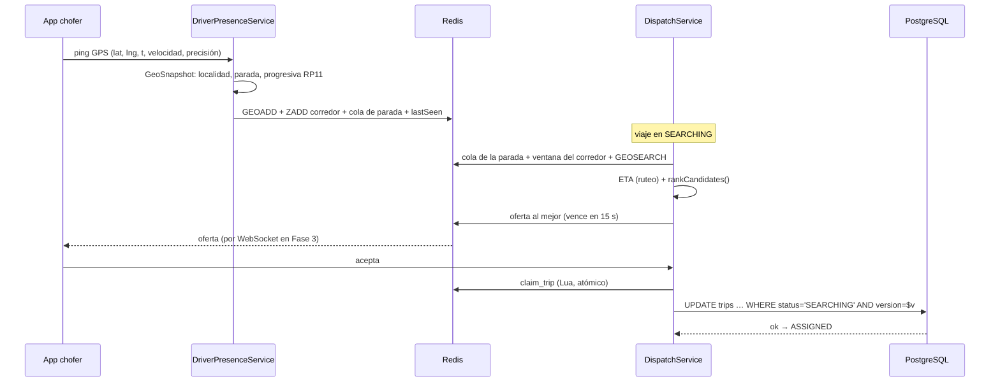
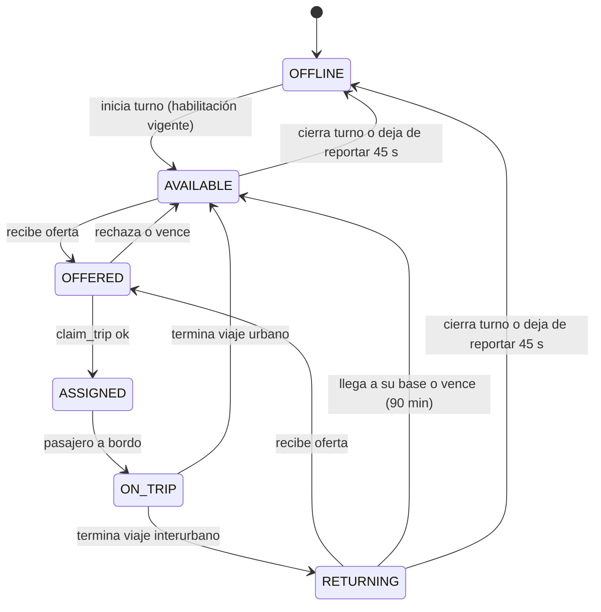
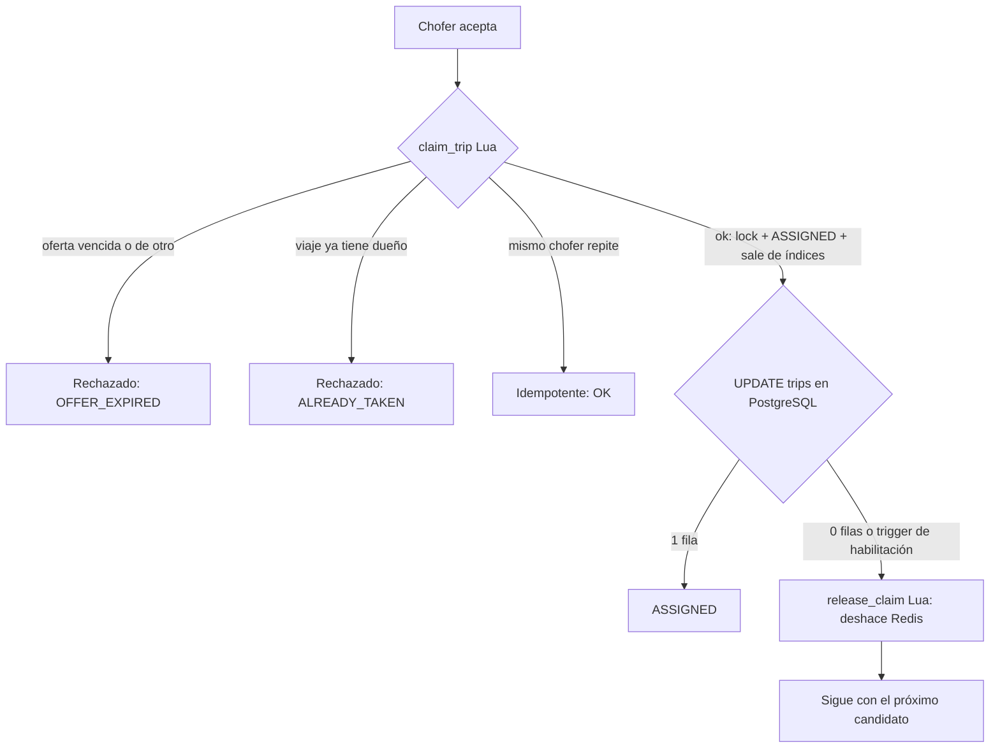

# Plan: Fase 2 · Redis GPS, colas de despacho y lock atómico

> Planeación original. Estado: **propuesta**, pendiente de aprobación.

## Decisiones tomadas

| Tema | Decisión |
|---|---|
| Alcance de la fase | Lógica de presencia, ingesta GPS, búsqueda de candidatos, ofertas y asignación atómica, como servicios de la API probados contra Redis y PostGIS reales. Los endpoints REST, los eventos WebSocket y la autenticación de choferes quedan para la Fase 3, que es la que va a llamar a estos servicios. |
| Cliente Redis | `ioredis`: scripts Lua con `defineCommand`, reconexión automática y soporte de Cluster para la Fase 6. |
| Geometría en cada ping | Las posiciones no van a PostGIS. Al arrancar, la API carga en memoria polígonos de localidades y zonas y el eje RP11 (`GeoSnapshot`). Pertenencia a la parada y progresiva se calculan en TS puro (`packages/domain`). PostGIS sigue siendo la fuente de verdad: el snapshot se refresca cada 5 min y un test de integración compara ambos cálculos. |
| Por qué no un radio | El partido mide ~100 km × 2-4 km. Un chofer a 2 km en línea recta puede estar a 2 km por RP11 o del otro lado de un tramo sin calles. Se combinan tres fuentes: la **cola de la parada** de origen, la **ventana sobre el corredor** (progresiva ± N m) y un `GEOSEARCH` acotado. El orden final lo da el ETA del proveedor de ruteo. |
| Ranking | Función pura `rankCandidates()` en `packages/domain`, determinística y testeable. Puntaje en "segundos equivalentes": ETA + penalizaciones − bonificaciones. |
| Viaje de Vuelta | El chofer que termina un viaje interurbano queda `RETURNING`, con localidad base y sentido de vuelta. Tiene prioridad fuerte en viajes que van en ese sentido y máxima si terminan en su base. En ese caso se recotiza con `assignedDriverBaseLocalityId`, se bonifica el retorno y el pasajero paga igual o menos que lo cotizado. |
| Ofertas | **Una oferta a la vez**, por chofer y por viaje, con vencimiento (15 s por defecto). Evita que dos choferes "ganen" el mismo viaje y que un chofer reciba dos viajes juntos. Después de 5 ofertas sin respuesta en una ronda, se amplía la búsqueda; sin chofer tras 3 min, el viaje pasa a `NO_DRIVER_AVAILABLE`. |
| Lock atómico | Script Lua `claim_trip`: en una sola operación de Redis verifica que la oferta vigente sea de ese chofer y que el viaje no tenga dueño. Si todo cierra, toma el lock y pasa al chofer a `ASSIGNED`. Después la base confirma con `UPDATE … WHERE status='SEARCHING' AND version=$v` (Fase 1). Si la base rechaza, un segundo script deshace lo hecho en Redis. |
| Varias réplicas de la API (verano) | Las instancias no guardan estado. Cada viaje en búsqueda tiene un "dueño" con lease renovable en Redis (`lc:trip:{id}:dispatcher`). Los vencimientos de ofertas viven en un ZSET y los toma una sola instancia por vez (Lua). Si una réplica muere, otra retoma el viaje cuando vence el lease. |
| Choferes desconectados | Cada ping renueva `lastSeen`. Un barrido cada 10 s saca de los índices a quien no reporta hace 45 s; no se depende de keyspace notifications. |
| Recorrido del viaje | Durante un viaje activo, los pings van a un Redis Stream y un consumidor los guarda por lotes en `trip_track_points`. Es *at-least-once*, con idempotencia por `(trip_id, recorded_at)`. Sirve para la tarifa final por GPS (Fase 3) y como evidencia ante el COM. |
| Redis caído | La cotización sigue funcionando (no usa Redis). El despacho automático se pausa y `/api/health` informa `degraded`. La asignación manual por operador sigue siendo segura, porque las garantías anti doble asignación también están en PostgreSQL. |
| Parámetros | En variables de entorno en esta fase. En la Fase 5 pasan a una tabla editable desde el panel municipal. |

## 1. El flujo completo

## 2. Estados del chofer (presencia en Redis)

- **Inicio de turno:** se exige `v_driver_vehicle_eligibility.is_eligible`.
- **Habilitación durante el turno:** se revisa cada 10 min y antes de cada oferta (caché de 60 s). Si vence a mitad de turno, el chofer no recibe más ofertas. Si estaba en viaje, lo termina.

## 3. Estructura en Redis

Prefijo `lc:`. `{svc}` es `TAXI` o `REMIS`.

| Clave | Tipo | Contenido |
|---|---|---|
| `lc:driver:{id}` | HASH | Estado, vehículo, servicio, base, última posición, progresiva, localidad, parada, acepta interurbano, datos de Viaje de Vuelta, viaje/oferta actual |
| `lc:geo:{svc}` | GEO | Choferes disponibles (`AVAILABLE` / `RETURNING`) por posición |
| `lc:corridor:{svc}` | ZSET | Mismos choferes, con score = progresiva RP11 en metros |
| `lc:zone:{zoneId}:queue` | ZSET | Cola FIFO de la parada (score = llegada; `ZADD NX` para no perder el lugar con cada ping) |
| `lc:drivers:lastseen` | ZSET | Último ping de cada chofer en turno (barrido de desconectados) |
| `lc:driver:{id}:rejections` | ZSET | Rechazos y vencimientos recientes (ventana de 30 min) |
| `lc:trip:{id}:offer` | STRING (PX) | Chofer con la oferta vigente |
| `lc:trip:{id}:lock` | STRING | Dueño definitivo del viaje (chofer) |
| `lc:trip:{id}:dispatcher` | STRING (PX) | Instancia de la API que despacha el viaje (lease) |
| `lc:offers:deadlines` | ZSET | Vencimiento de cada oferta pendiente |
| `lc:gps:track` | STREAM | Pings de viajes activos, consumidos por grupo hacia PostgreSQL |

## 4. Ingesta de posiciones

`DriverPresenceService.ingest(driverId, pings[])` acepta lotes, porque la app guarda los pings mientras no hay señal y los manda juntos.

| Caso | Tratamiento |
|---|---|
| Ping más viejo que el último aplicado | No mueve al chofer; si está en viaje, igual va al recorrido |
| Precisión peor que 100 m | Cuenta como señal de vida, pero no actualiza la posición de despacho |
| Salto imposible (más de 180 km/h entre pings) | No mueve al chofer y se registra como sospechoso, con contador para el panel en Fase 5 |
| Reloj del celular adelantado (más de 2 min) | Se usa la hora del servidor |
| Lote desordenado | Se ordena por tiempo; solo el último válido define la presencia |
| Chofer `OFFLINE` | Se rechaza: primero tiene que iniciar turno |

Cada ping válido actualiza en un `MULTI`:

- El HASH del chofer.
- `GEO` y `corridor`, si está disponible.
- La cola de la parada: entra si está dentro de la zona y sale si la abandona.
- `lastseen`.

## 5. Búsqueda y ranking de candidatos

1. **Ronda 1:**
   - Cola de la parada que contiene el origen.
   - Ventana del corredor de ±4 km alrededor de la progresiva del origen.
   - `GEOSEARCH` de 2,5 km.

   Se juntan los resultados, se filtran por servicio, estado, habilitación y preferencia interurbana, y se quitan los que tienen una oferta abierta.
2. **ETA:** se pide al proveedor de ruteo para los 8 mejores por distancia sobre el corredor. Si el ruteo está degradado, se usa la distancia geodésica.
3. **`rankCandidates()`:** puntaje = ETA + penalizaciones − bonificaciones.
   - Penalizaciones: 60 s por rechazo o vencimiento reciente, con tope.
   - Bonificaciones:
     - Viaje de Vuelta: hasta 300 s si el viaje va en su sentido; 600 s si termina en su base.
     - Posición en la cola de la parada: 120 s el primero, decreciente.
     - Tiempo esperando sin viaje: hasta 60 s.

   Desempate determinístico por id.
4. **Rondas 2 y 3:** corredor ±10 km y luego ±25 km. Después de la ronda 3, `NO_DRIVER_AVAILABLE`.

Cada oferta se registra en `trip_offers`, con rango, puntaje, ETA y resultado. Queda auditable para el municipio: por qué se ofreció a uno y no a otro.

## 6. Oferta, aceptación y lock atómico

- **Rechazo o vencimiento:** el chofer vuelve a `AVAILABLE` y el viaje pasa al siguiente candidato. El vencimiento lo procesa una sola instancia, con `ZRANGEBYSCORE` + `ZREM` en Lua.
- **Cancelación del pasajero durante una oferta:** se borra la oferta y una aceptación posterior recibe `TRIP_CANCELLED`.
- **Viaje de Vuelta:** si el ganador es un chofer `RETURNING` cuya base es el destino, se recotiza con `FareCalculatorService` y se guarda `is_backhaul_assignment = true`. La tarifa nunca sube.

## 7. Cambios en la base de datos

Migración nueva `AAAAMMDDHHMMSS_despacho_y_recorrido.sql`, con fecha de implementación:

- **`trip_offers`:** viaje, chofer, ronda, rango, puntaje, ETA, `offered_at`, `responded_at`, `outcome` (`ACCEPTED`, `REJECTED`, `EXPIRED`, `SUPERSEDED`, `CLAIM_FAILED`) e instancia. Índices por viaje y por chofer y fecha.
- **`trip_track_points`:**
  - Columnas: viaje, chofer, `recorded_at`, `geom` (Point), velocidad, rumbo, precisión.
  - Índices: `UNIQUE (trip_id, recorded_at)`, `GIST(geom)` y `BRIN(recorded_at)`.
- **`drivers.accepts_interurban`:** `boolean NOT NULL DEFAULT true`.
- **`trips`:** columnas `dispatch_round` y `dispatch_started_at`.
- **`docs/MODELO_DATOS.md`:** se actualiza en el mismo cambio.

## 8. Código

| Dónde | Qué |
|---|---|
| `packages/domain/src/geo-snapshot.ts` | Punto en polígono, proyección sobre polilínea (progresiva) y distancia lateral |
| `packages/domain/src/dispatch-ranking.ts` | `rankCandidates()` y tipos de candidato y parámetros |
| `apps/api/src/redis/` | Módulo Redis (`ioredis`), scripts Lua versionados en `.lua` y health |
| `apps/api/src/modules/presence/` | `GeoSnapshotService` (carga desde PostGIS), `DriverPresenceService` (turno, ingesta, liberación), barrido de desconectados |
| `apps/api/src/modules/dispatch/` | `DispatchService` (rondas, ofertas, aceptación, rechazo), *ticker* de vencimientos, leases, repositorio de `trip_offers` |
| `apps/api/src/modules/tracking/` | Consumidor del Stream → `trip_track_points` por lotes |

## 9. Pruebas

- **Unitarias:**
  - `rankCandidates()`: Viaje de Vuelta, cola, penalizaciones y desempate.
  - Geometría pura.
  - Filtros de ingesta.
- **Integración con Redis y PostGIS reales (Docker):**
  - Paridad entre la progresiva y la parada calculadas en TS y en PostGIS.
  - **Concurrencia:** 50 aceptaciones en paralelo de choferes distintos y de varias "instancias" contra el mismo viaje → exactamente 1 gana, y la base queda consistente.
  - Aceptación tardía de una oferta vencida → rechazada.
  - Falla de la base después del `claim_trip` → Redis queda deshecho.
  - Chofer desconectado → sale de los índices.
  - Lease de dispatcher vencido → otra instancia retoma.
  - Viaje de Vuelta prioriza y bonifica.
  - Recorrido persistido sin duplicados tras reintentos.
- **Simulación** (`pruebas/simular-temporada.ts`): 300 choferes repartidos en el corredor que reportan cada 5 s y una ráfaga de 200 pedidos en 2 minutos. Mide tiempo de asignación (p50/p95), pedidos sin chofer y que nunca haya doble asignación. Es una referencia para la Fase 6, no una prueba de carga completa.

## 10. Requisitos antes de empezar

- Redis 7.4 ya está en `docker-compose.yml` (`:56379`). No hace falta instalar nada en la máquina.
- Dependencia nueva: `ioredis`, que tiene que pasar la política de pnpm (7 días, `trustPolicy`).
- Sin datos oficiales de paradas: se usan las 5 zonas del seed de la Fase 1.

## 11. Orden de implementación

1. Migración de despacho y recorrido, y actualización de `MODELO_DATOS.md`.
2. Geometría pura y `rankCandidates()` en `packages/domain`, con sus tests.
3. Módulo Redis y scripts Lua (`claim_trip`, `release_claim`, `expire_offers`, `acquire_lease`).
4. `GeoSnapshotService` y `DriverPresenceService` (turno, ingesta, barrido).
5. `DispatchService`: candidatos, ofertas, aceptación, rechazo, vencimientos y leases.
6. Consumidor de recorrido.
7. Tests de integración y concurrencia.
8. Simulación de temporada.
9. `DOCUMENTACION.md`, `GUIA_IMPLEMENTACION.md`, índice y `PENDIENTES.md`.
