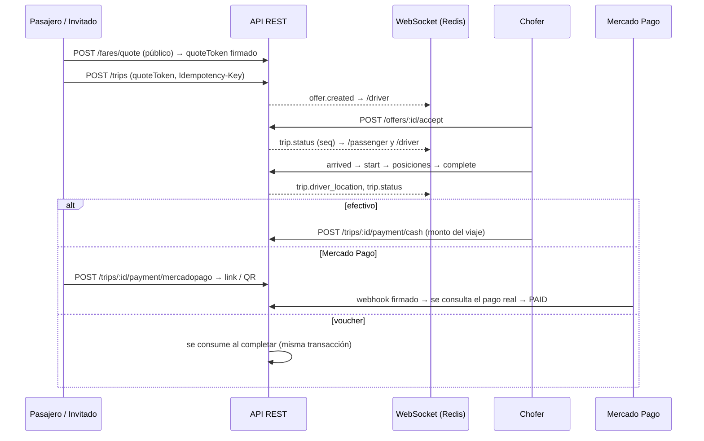
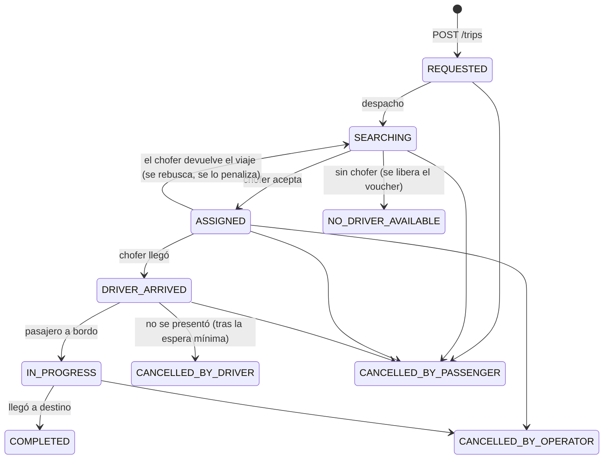

# Fase 3 · API REST, WebSockets, pagos/vouchers y alerta COM: documentación

## Qué hace

Expone el sistema a las tres aplicaciones (web municipal, app del pasajero con su Modo Invitado por QR, y app del chofer):

- Cuatro formas de entrar.
- El ciclo de vida completo del viaje, por REST y en tiempo real por WebSocket.
- Los cobros: efectivo, Mercado Pago y vouchers o Cuenta Corriente Municipal.
- El botón de pánico conectado al Centro de Operaciones Municipal (COM).

Todo endpoint exige sesión por defecto; solo los marcados como públicos se abren. Cada acción verifica que quien la pide sea la parte que corresponde: el pasajero de ese viaje, su chofer asignado, o un operador con el rol adecuado. Los montos y los datos sensibles salen siempre del servidor, nunca del cuerpo del pedido.

## Las cuatro formas de entrar

| Usuario | Cómo entra | Detalle |
|---|---|---|
| Pasajero registrado | Teléfono + código SMS | `POST /auth/passenger/otp` y `/verify`. Máximo 3 códigos cada 10 min, 5 intentos por código y consumo atómico |
| Pasajero invitado (QR) | Código del QR pegado en paradas y hoteles | `POST /auth/guest`. El QR va firmado con `QR_SECRET`; uno inventado no abre sesión. `ALLOW_UNSIGNED_QR` es solo para desarrollo |
| Chofer | DNI + PIN de 6 dígitos que entrega Tránsito | Bloqueo de 15 min tras 5 intentos. Al entrar recibe los vehículos que puede manejar hoy |
| Operador | Usuario + contraseña | Roles `COM_OPERATOR`, `AGENCY_OPERATOR` (solo su agencia) y `MUNICIPAL_ADMIN` |

**Sesión:**
- Todos reciben un JWT de acceso de 15 min y un refresh token.
- El refresh token sirve una sola vez. Si alguien presenta uno ya usado (por ejemplo, robado), se revoca toda la sesión.
- Al refrescar se vuelven a leer el rol y el estado, así que un operador desactivado no sobrevive a su token.

**Secretos:** `JWT_SECRET` y `QR_SECRET` son obligatorios (mínimo 32 caracteres) y no tienen valor por defecto. Sin ellos la API no arranca.

`POST /auth/guest-qr-codes` (`MUNICIPAL_ADMIN`) genera el contenido de un QR firmado para imprimir.

## Permisos

| Quién | Puede |
|---|---|
| Sin sesión | Cotizar, listar localidades, `health`, entrar y el webhook de Mercado Pago (protegido por su firma) |
| Pasajero / invitado | Pedir, ver, seguir, cancelar y calificar **sus** viajes; cambiar el destino; pagar con Mercado Pago; pánico |
| Chofer | Turno, posiciones y ofertas; mover **su** viaje asignado; cobrar en efectivo; pánico |
| `COM_OPERATOR` | Ver la flota y cualquier viaje, cancelar viajes, atender alertas |
| `AGENCY_OPERATOR` | Ver la flota y los viajes de **su** agencia, y cancelarlos |
| `MUNICIPAL_ADMIN` | Lo mismo que el COM (ver flota y viajes, cancelar), más vouchers y programas, generar QR y leer alertas |

Un viaje ajeno responde 404, igual que uno que no existe: no se revela qué ids son válidos. Ningún listado devuelve hashes de PIN.

## Ciclo de vida del viaje

La máquina de estados está en `packages/domain/src/trip-lifecycle.ts`, es pura y está testeada. La API la aplica dentro de una transacción con la fila bloqueada.

**Pasos de cada acción:**

1. Bloquea el viaje.
2. Verifica la parte que la pide.
3. Aplica la transición.
4. Registra el evento en `trip_events`.
5. Mueve el voucher, en la misma transacción.

**Después del commit**, en Redis:
- Libera al chofer (que puede quedar en Viaje de Vuelta).
- Retira la oferta abierta o re-despacha.
- Avisa por WebSocket.

**Si Redis falla en ese momento**, cada 30 s un reconciliador compara Redis con PostgreSQL y corrige. PostgreSQL manda.

**Reglas:**
- **Tarifa cerrada:** se paga lo cotizado. Al completar, el servidor calcula además un **taxímetro de referencia** con el recorrido GPS (`metered_fare_cents`), para auditoría y reclamos; no se cobra. Un valor enviado por la app se ignora.
- **Precio garantizado:** `POST /fares/quote` devuelve un `quoteToken` (la cotización firmada, válida 10 min). Con él, el viaje se crea a ese precio; una cotización adulterada da 400. Sin token, se cotiza de nuevo al crear.
- **Un viaje abierto por pasajero:** un segundo pedido da 409 `PASSENGER_HAS_OPEN_TRIP`, aunque no venga `Idempotency-Key`.
- **Cambio de destino:** `POST /trips/:id/destination` sin token devuelve la propuesta con el mismo `pricingInstant`; con el token de esa propuesta, la aplica y ajusta la reserva del voucher.
- **"No se presentó":** el chofer cancela con `noShow: true` después de esperar `TRIP_NO_SHOW_WAIT_MS` (5 min por defecto). El cargo por cancelación sigue en 0 hasta que lo defina el municipio.

## Tiempo real y mala señal

| Canal | Quién | Recibe |
|---|---|---|
| `/driver` | Chofer | `offer.created`, `offer.closed`, `trip.status`, `trip.cancelled`; envía `position` |
| `/passenger` | Pasajero o invitado | `trip.status`, `trip.driver_location` (cada 5 s como máximo), `trip.fare_changed`, `payment.status` |
| `/com` | `COM_OPERATOR` y `MUNICIPAL_ADMIN` | `panic.snapshot` al conectar, `panic.alert`, `panic.location`, `panic.escalated`, `panic.updated`; puede seguir un viaje con `watch_trip` |

**Garantías de entrega:**
- **Varias réplicas:** con el adaptador de Redis, un evento emitido en una réplica llega a los clientes conectados a cualquier otra.
- **Eventos perdidos:** cada evento de un viaje lleva `seq`. El cliente se (re)suscribe con `subscribe` o `resume` y su último `seq`, y recibe en orden solo lo que se perdió. Por REST está `GET /trips/:id/events?afterSeq=`.
- **Suscripciones:** solo se puede seguir un viaje propio.
- **Oferta vigente:** el chofer que reconecta la recibe de nuevo.
- **Reintentos sin duplicar:** las acciones del chofer aceptan `clientEventId`, y los POST críticos aceptan `Idempotency-Key`. La misma clave con otro cuerpo da 409.
- **Redis caído:** si una promesa del adaptador queda rechazada, se registra en el log y la API sigue atendiendo, en lugar de cerrarse.

## Pagos

| Método | Cómo se cobra |
|---|---|
| Efectivo | El chofer confirma al terminar (`POST /trips/:id/payment/cash`). El monto es el del viaje; uno enviado por el cliente se ignora. Una sola vez |
| Mercado Pago (QR / link) | Checkout Pro: el link y el QR (el mismo link dibujado) por el monto del viaje. El webhook verifica la firma `x-signature` de Mercado Pago, **consulta el pago al proveedor** y compara el monto. Si el monto no coincide, el pago queda `FAILED`. Es idempotente ante reintentos |
| Voucher / Cuenta Corriente Municipal | Se reserva el cotizado al pedir y se ajusta si cambia el destino. Al terminar se consume el final y se libera el resto; al cancelar o quedar sin chofer, se libera todo. Voucher y programa se bloquean, así que dos viajes simultáneos no gastan el mismo saldo ni pasan el presupuesto del programa |

- `PAYMENTS_PROVIDER=fake` simula Mercado Pago en desarrollo y tests.
- Los vouchers y programas solo los crea `MUNICIPAL_ADMIN`. El saldo no se mueve por endpoints: lo maneja el ciclo del viaje.
- Del DNI del beneficiario se guarda solo un HMAC.

## Pánico y COM

- `POST /panic` funciona con cualquier sesión de pasajero (también la invitada) o de chofer.
- **Datos de la alerta:** quién la levanta, el chofer, el vehículo y el viaje salen de la sesión y de la base. La foto (`snapshot`) la arma el servidor, y lo que mande el cliente en esos campos se ignora.
- **Idempotencia:** es por `clientEventId`. Si otro usuario reutiliza el mismo id, da 409.
- **Posición en vivo:** la del chofer llega sola con sus pings; la del pasajero, por `POST /panic/:id/location`.
- **Escalamiento:** si nadie la atiende en `PANIC_ESCALATE_AFTER_MS` (60 s), se escala, se reenvía al COM y se avisa por el canal externo (`IAlertNotifier`; en desarrollo, el log).
- **Estados:** `OPEN → ACKNOWLEDGED → UNITS_DISPATCHED → RESOLVED` o `FALSE_ALARM`. Se puede cerrar directamente desde `OPEN`, y una alerta no la pueden tomar dos operadores.

## Qué cambia para cada rol

| Rol | Qué cambia |
|---|---|
| Pasajero registrado | Entra con su teléfono; pide con precio garantizado; sigue el viaje en vivo y recupera lo perdido si se corta la señal; paga en efectivo, por Mercado Pago o con voucher; califica; botón de pánico |
| Pasajero invitado (QR) | Lo mismo, sin registrarse, desde el QR firmado de la parada u hotel |
| Chofer | Entra con DNI + PIN; turno; ofertas en vivo (y la vigente al reconectar); maneja su viaje; puede devolverlo antes de llegar (con penalización); cobra en efectivo; pánico |
| Agencia de remises | Ve su flota y los viajes de su agencia, y los puede cancelar |
| Operador del COM | Recibe las alertas al instante, con posición en vivo y escalamiento; ve cualquier viaje y lo puede cancelar |
| Administración municipal | Crea programas, vouchers y QR; ve flota, tarifas y alertas |

## Privacidad y datos personales

**Datos que se guardan:**
- Pasajero registrado: el teléfono.
- Invitado: solo el hash de su sesión.
- PIN, contraseñas y códigos OTP: siempre como hash `scrypt`.
- Refresh tokens: solo su hash.
- DNI de beneficiarios de vouchers: un HMAC, no el DNI.
- No se guarda el motivo médico de los programas de salud o discapacidad: solo el programa.

**Lo que ve cada parte:** el pasajero ve el nombre e inicial del apellido del chofer y los datos del vehículo. El COM ve el teléfono del chofer y del pasajero. El chofer no ve el teléfono del pasajero.

**Pendiente con el municipio** (Ley 25.326): plazos de conservación de alertas y snapshots, del recorrido GPS y de los eventos del viaje.

## Dónde está cada cosa

| Qué | Archivo / ubicación |
|---|---|
| Máquina de estados y resumen de recorrido | `packages/domain/src/trip-lifecycle.ts`, `track-summary.ts` |
| Seguridad (guard global, roles, JWT, cotización firmada, idempotencia, límites) | `apps/api/src/security/` |
| Login de los cuatro tipos de usuario y QR firmados | `apps/api/src/modules/auth/` |
| Ciclo del viaje, cambio de destino, reconciliador | `apps/api/src/modules/trips/` |
| WebSockets (3 canales) y servicio de tiempo real | `apps/api/src/modules/realtime/`, `common/redis-io.adapter.ts` |
| Bitácora de eventos (`seq`) | `apps/api/src/modules/trip-events/` |
| Pagos y proveedor Mercado Pago / simulado | `apps/api/src/modules/payments/` |
| Vouchers y programas | `apps/api/src/modules/vouchers/` |
| Pánico, COM y escalamiento | `apps/api/src/modules/panic/` |
| Migración nueva de esta rehechura | `packages/db/migrations/20261122100000_pagos_mp_y_eventos.sql` |
| Documentación OpenAPI | `GET /api/docs` |
