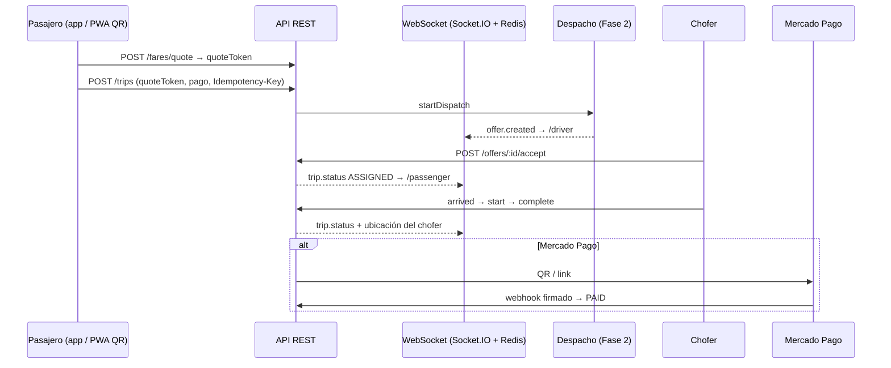
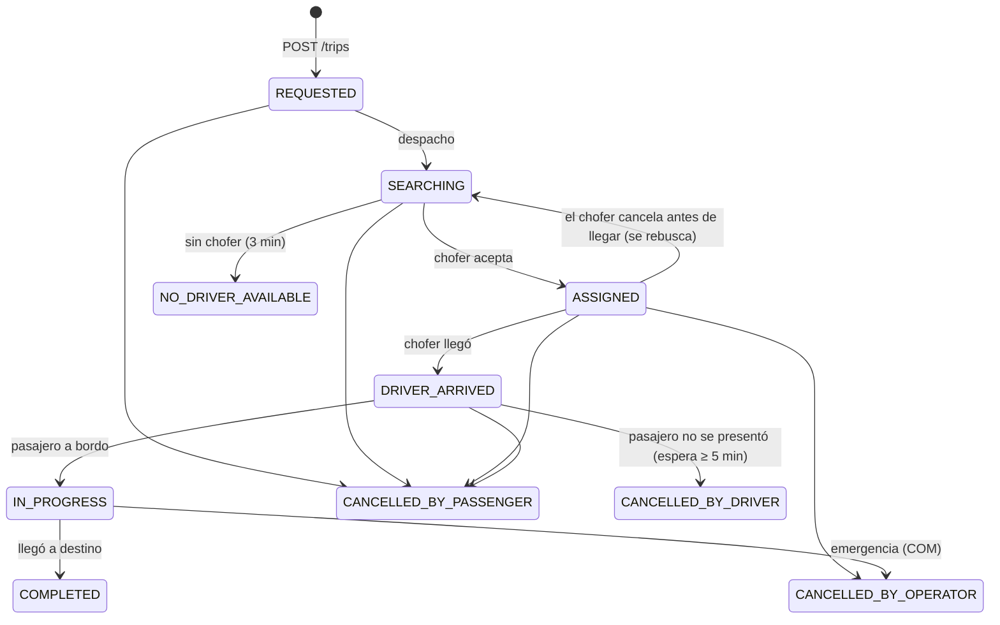

# Plan: Fase 3 · API REST, WebSockets, pagos/vouchers y alerta COM

> Planeación original. Estado: **aprobado el 2026-11-21**. Implementación iniciada por el agente de base de datos (migración `20261121090000_api_pagos_com.sql`).

## Decisiones tomadas

| Tema | Decisión |
|---|---|
| Ciclo de vida del viaje | Máquina de estados **pura** en `packages/domain` (`tripTransition()`): qué transición se permite, quién la puede pedir y qué datos exige. La API solo la aplica. Cada transición se guarda en una transacción con control optimista (`version`) y deja un registro en `trip_events`. |
| Estados expuestos | `REQUESTED → SEARCHING → ASSIGNED → DRIVER_ARRIVED → IN_PROGRESS → COMPLETED`, más las cancelaciones y `NO_DRIVER_AVAILABLE`. `DRIVER_EN_ROUTE` existe en el esquema pero no se usa: ya está implícito en `ASSIGNED`. |
| Tarifa | **Tarifa cerrada**: el pasajero paga lo cotizado al confirmar. Solo cambia si hay un cambio de destino pedido por el pasajero (se recotiza con `pricingInstant` = inicio del viaje) o una espera extra, que se cobra en fichas de espera. Con el recorrido GPS se calcula además un **taxímetro de referencia** (`metered_fare_cents`), que sirve para auditoría y reclamos y no se cobra. |
| Precio garantizado | La cotización devuelve un `quoteToken` firmado (HMAC-SHA256, 10 min). Para crear un viaje hay que presentarlo: la API verifica la firma y que origen, destino y servicio coincidan. Así nadie puede inventar un precio, y no hace falta guardar todas las cotizaciones. |
| Autenticación | JWT de acceso corto (15 min) + refresh token rotativo (hash en la base, se revoca al reutilizarse). Librería `jose`. |
| Quién entra y cómo | **Chofer:** DNI + PIN de 6 dígitos que entrega Tránsito (hash `scrypt`, bloqueo tras 5 intentos). **Pasajero registrado:** teléfono + código por SMS. **Pasajero invitado (QR):** el QR de cada parada u hotel trae un código firmado; al escanearlo se crea una sesión invitada, sin registro. **Operador** (COM, agencia, municipio): usuario + contraseña con rol. |
| SMS | Interfaz `ISmsProvider`. En desarrollo el código se escribe en el log. El proveedor real se elige con el municipio. |
| WebSockets | Socket.IO con tres espacios (`/driver`, `/passenger`, `/com`) y el adaptador de Redis (`@socket.io/redis-adapter`). Un evento emitido en cualquier réplica llega a los clientes conectados a otra. Se autentica con el mismo JWT. |
| Mala señal y reconexión | Todo lo del WebSocket también existe por REST: la app puede hacer polling si el socket no conecta. Cada evento de un viaje lleva un `seq` creciente (el id de `trip_events`). Al reconectar, el cliente manda el último `seq` que recibió y el servidor le reenvía lo que se perdió. Las acciones del chofer y del pasajero llevan `clientEventId`, así un reintento no se aplica dos veces. Al reconectar, el chofer recibe de nuevo su oferta vigente. |
| Idempotencia HTTP | Header `Idempotency-Key` en crear viaje, pánico y pagos. Tabla `idempotency_keys` con la respuesta guardada 24 h; la misma clave con otro cuerpo da 409. |
| Mercado Pago | Interfaz `IPaymentProvider`, con una implementación sobre la API REST de Mercado Pago (`fetch`, sin SDK) y una falsa para desarrollo y tests. Soporta QR dinámico y link de pago (Checkout Pro). El webhook valida la firma `x-signature` y es idempotente. Split a la cuenta de la agencia o del chofer (`agencies.mp_collector_id`) por modelo marketplace, si el municipio tiene la cuenta habilitada. |
| Efectivo | El chofer confirma el cobro al terminar → `PAID`. |
| Vouchers y Cuenta Corriente Municipal | Tablas de programas (salud, discapacidad, empleados) con presupuesto por período, vouchers con saldo y vigencia, y movimientos. Al asignar el viaje se **reserva** el monto cotizado; al terminar se **consume** el final y al cancelar se **libera**. Se usa `SELECT … FOR UPDATE` para que dos viajes simultáneos no gasten el mismo saldo. No se guarda el motivo médico, solo el programa. |
| Pánico → COM | `POST /panic`: funciona con cualquier sesión, incluida la invitada, y es idempotente por `clientEventId`. La alerta llega al instante a `/com` con un snapshot de chofer, vehículo, pasajero y viaje, y con la **posición en vivo** mientras siga abierta. Si nadie la atiende en 60 s, se reenvía y se avisa por un canal externo (`IAlertNotifier`, en desarrollo un log). El `pg_notify` de la Fase 1 queda como canal de respaldo. |
| Documentación de la API | OpenAPI con `@nestjs/swagger` en `/api/docs`. |
| Límite de pedidos | Límite por sesión e IP en cotizar, crear viaje y login (Redis), para frenar abusos del modo invitado. |

## 1. El flujo completo

## 2. Máquina de estados del viaje

**Reglas:**
- **El chofer cancela antes de llegar:** el viaje vuelve a búsqueda y no se le corta al pasajero. Al chofer se le penaliza en el ranking.
- **Cancelación del pasajero con el chofer ya en la puerta:** queda registrada. El cargo por cancelación **no** se cobra hasta que lo defina el municipio.
- **Cambio de destino durante el viaje:** `POST /trips/:id/destination` recotiza con el instante de inicio, y el pasajero acepta el precio nuevo antes de que se aplique.
- **Fin del viaje:** al completarlo, en la misma operación se cierra en la base, se libera al chofer en Redis (`releaseAfterTrip`, que puede dejarlo en Viaje de Vuelta), se calcula el taxímetro de referencia y se registra o inicia el cobro.

## 3. API REST (v1)

| Quién | Endpoint | Para qué |
|---|---|---|
| Pasajero | `POST /auth/passenger/otp`, `/auth/passenger/verify` | Entrar con teléfono |
| Invitado | `POST /auth/guest` | Sesión desde el código del QR |
| Chofer | `POST /auth/driver` | DNI + PIN |
| Todos | `POST /auth/refresh`, `/auth/logout` | Renovar y cerrar sesión |
| Pasajero | `POST /fares/quote` | Ya existe; suma `quoteToken` |
| Pasajero | `POST /trips`, `GET /trips/:id`, `GET /trips/:id/events?afterSeq=` | Pedir, consultar y recuperar eventos perdidos |
| Pasajero | `POST /trips/:id/cancel`, `/destination`, `/rate` | Cancelar, cambiar destino, calificar |
| Chofer | `POST /drivers/me/shift`, `DELETE /drivers/me/shift`, `POST /drivers/me/positions` | Turno y GPS (servicios de la Fase 2) |
| Chofer | `GET /drivers/me/offer`, `POST /offers/:id/accept`, `/reject` | Ofertas |
| Chofer | `POST /trips/:id/arrived`, `/start`, `/complete`, `/cancel`, `/payment/cash` | Ciclo del viaje |
| Pago | `POST /trips/:id/payment/mercadopago`, `POST /payments/mercadopago/webhook` | QR / link y confirmación |
| Todos | `POST /panic` | Botón de pánico |
| COM | `GET /com/alerts`, `POST /com/alerts/:id/ack`, `/units-dispatched`, `/resolve` | Atención de alertas |
| COM / Municipio | `GET /com/trips/:id` | Viaje con recorrido y eventos |
| Municipio | CRUD mínimo de programas y vouchers | El panel completo es de la Fase 5 |

Todos los errores mantienen el formato de las fases 1 y 2: `{ error, message, details }`.

## 4. Eventos WebSocket

| Espacio | Sala | Eventos |
|---|---|---|
| `/driver` | `driver:{id}` | `offer.created`, `offer.closed`, `trip.status`, `trip.cancelled` |
| `/passenger` | `trip:{id}` | `trip.status`, `trip.driver_location` (cada 5 s como máximo), `trip.fare_changed`, `payment.status` |
| `/com` | `com` | `panic.alert`, `panic.location`, `panic.escalated`, `panic.updated` |

Cada evento de un viaje lleva `{ seq, tripId, type, at, data }`. El cliente que reconecta manda `resume { tripId, afterSeq }` y recibe lo que se perdió. Los mensajes del cliente al servidor (`position`, `accept`) llevan `clientEventId`.

## 5. Cambios en la base de datos

Migración nueva `AAAAMMDDHHMMSS_api_pagos_com.sql`, con fecha de implementación:

| Cambio | Detalle |
|---|---|
| `operator_users` | Usuario, hash `scrypt`, rol (`COM_OPERATOR`, `AGENCY_OPERATOR`, `MUNICIPAL_ADMIN`), agencia si corresponde, bloqueo |
| `drivers` | `pin_hash`, `pin_failed_attempts`, `pin_locked_until` |
| `auth_refresh_tokens` | Hash, sujeto, familia (para detectar reutilización), vencimiento, revocado |
| `otp_challenges` | Teléfono, hash del código, intentos, vencimiento |
| `idempotency_keys` | Clave, actor, hash del cuerpo, respuesta guardada, vencimiento |
| `trips` | `metered_fare_cents`, `final_breakdown`, `passenger_rating`, `cancellation_fee_cents` (siempre 0 por ahora) |
| `payments` | Viaje, método, monto, estado, referencia del proveedor, link o QR, datos del webhook, idempotencia |
| `municipal_programs` | Nombre, tipo, presupuesto por período |
| `vouchers` | Código, programa, saldo, vigencia, DNI del beneficiario opcional (cifrado o hash) |
| `voucher_movements` | Reserva, consumo, liberación |
| `panic_alerts` | `escalated_at`, `escalation_count` |
| Índices | Los necesarios: sesiones por sujeto, pagos por viaje y por referencia, movimientos por voucher |

`docs/MODELO_DATOS.md` se actualiza en el mismo cambio.

## 6. Requisitos antes de empezar

- **Dependencias nuevas**, que tienen que pasar la política de pnpm (7 días, `trustPolicy`): `jose`, `@nestjs/websockets`, `@nestjs/platform-socket.io`, `socket.io`, `@socket.io/redis-adapter`, `@nestjs/swagger`, y `socket.io-client` solo para tests.
- **Mercado Pago:** para probar contra el sandbox real hacen falta credenciales de prueba (Access Token y secreto del webhook) de una cuenta de desarrollador. Las cargás vos en el `.env`; yo no las ingreso ni las veo. Sin ellas, todo se prueba con el proveedor falso y con webhooks firmados en los tests. El split marketplace requiere que la cuenta del municipio lo tenga habilitado.
- **Decisiones del municipio**, que hasta entonces quedan configurables con un valor por defecto:
  - Cargo por cancelación (0).
  - Minutos de espera por "no se presentó" (5).
  - Plazo para escalar una alerta (60 s).
  - Proveedor de SMS.

## 7. Orden de implementación

1. Migración y `MODELO_DATOS.md`.
2. Máquina de estados del viaje, firma de cotizaciones y taxímetro de referencia en `packages/domain`, con tests.
3. Autenticación: JWT, refresh rotativo, PIN del chofer, OTP del pasajero, sesión invitada y operadores, más los guards por rol.
4. Idempotencia y límite de pedidos.
5. Endpoints del pasajero y del chofer, conectados al despacho y la presencia de la Fase 2.
6. WebSockets con el adaptador de Redis, reenvío por `seq` y oferta vigente al reconectar.
7. Pagos: efectivo, proveedor de Mercado Pago (real y falso), webhook firmado, vouchers con reserva, consumo y liberación.
8. Pánico y COM: alerta en vivo, posición, escalamiento y atención.
9. OpenAPI en `/api/docs`.
10. Tests:
    - Viaje completo de punta a punta por HTTP + WebSocket.
    - Reconexión con reenvío de eventos.
    - Dos réplicas: un evento de una llega a un socket conectado a la otra.
    - Vouchers en paralelo sin gastar de más.
    - Webhook con firma válida e inválida.
    - Pánico con el COM conectado y escalamiento.
11. `DOCUMENTACION.md`, `GUIA_IMPLEMENTACION.md`, índice y `PENDIENTES.md`.
