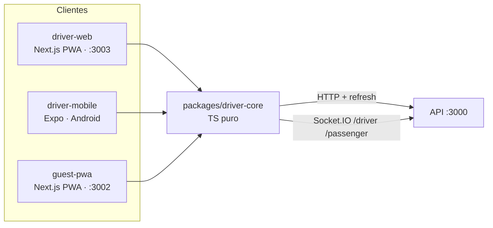
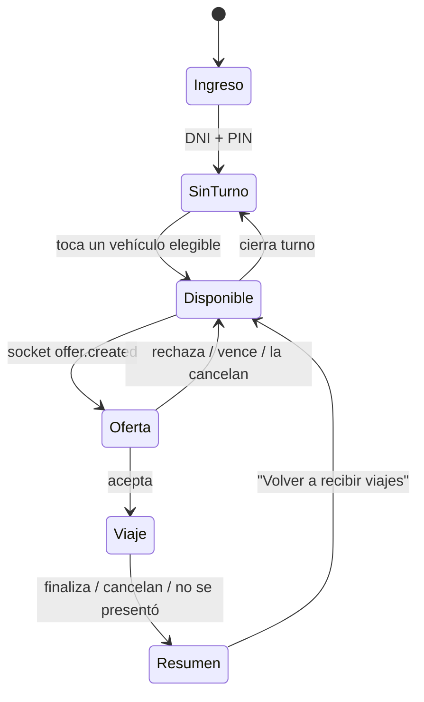

# Documentación: Fase 4, app del chofer (web y Expo) y Modo Invitado

Hay tres apps cliente: el chofer en web, el chofer en Expo y el invitado por QR. Las tres comparten la lógica a través de `packages/driver-core` y usan la API de la Fase 3 sin cambios de contrato. Solo se agregaron dos endpoints de lectura para el chofer.



## `packages/driver-core`

TypeScript sin React, DOM ni React Native. Next.js lo compila con `transpilePackages` y Metro (Expo) lo lee como fuente.

| Módulo | Qué hace |
|---|---|
| `api.ts` | `ApiClient`: `fetch` y el almacenamiento de la sesión se inyectan. Ante un 401 renueva **una sola vez** con `POST /auth/refresh`, aunque haya llamadas en paralelo, y reintenta. Si la renovación falla, borra la sesión y llama a `onSessionExpired`. Los errores llegan como `ApiError` con un mensaje en castellano; `isNetwork` indica que no hubo conexión. `uuid()` funciona aunque no haya `crypto`. |
| `endpoints.ts` | `DriverApi` (login, perfil, vehículos, turno, posiciones, ofertas, transiciones, cobro en efectivo, pánico) y `PassengerApi` (QR de invitado, cotización, crear viaje con `quoteToken` e `Idempotency-Key`, cancelar, calificar, Mercado Pago, pánico). Las transiciones llevan `clientEventId`. |
| `trip.ts` | Qué acciones tiene el chofer en cada estado. "No se presentó" queda deshabilitado hasta cumplir la espera. También los textos y los pasos que ve el pasajero. Los estados de origen replican `TRIP_TRANSITIONS` del dominio y un test verifica que coincidan. |
| `pings.ts` | `PingBuffer`: junta las posiciones, descarta las imprecisas o fuera de orden, manda lotes y, si falla un envío, conserva lo pendiente (hasta 500 puntos, los más nuevos). `simulatedPosition()` mueve un auto en línea recta para pruebas. |
| `realtime.ts` | `connectRealtime(io, api, canal, handlers)`: el token se pide en cada intento de conexión, así el socket reconecta con la sesión renovada. Al reconectar pide los eventos perdidos (`subscribe`/`resume` con `afterSeq`). |
| `format.ts` | Pesos (`$ 2.200,00`), distancias, tiempos, cuenta regresiva, distancia entre dos puntos y textos en español de servicio, alcance, temporada, franja, forma y estado de pago, y motivos de bloqueo. |

## API (agregado)

| Endpoint | Rol | Devuelve |
|---|---|---|
| `GET /drivers/me` | DRIVER | Nombre, teléfono, estado, agencia, localidad base, número de habilitación y vencimientos (AAAA-MM-DD). Sin PIN. |
| `GET /drivers/me/vehicles` | DRIVER | Vehículos autorizados (sale de `v_driver_vehicle_eligibility`): patente, servicio, marca, modelo, año, color, `is_eligible` y `blocking_reasons`. Primero los elegibles. |

## App del chofer web (`apps/driver-web`)



- **Una sola página.** Las pantallas sin turno, disponible, viaje y resumen se muestran según `GET /drivers/me/state`, así que recargar no pierde el viaje. Arriba está el mapa (Leaflet + OpenStreetMap) y abajo un panel con la acción del momento.
- **Encabezado:** nombre, estado, patente e indicador de conexión ("En línea" / "Reconectando"). Sin socket, la app consulta cada 8 s.
- **Vehículos:** tarjetas por patente. Los bloqueados muestran el motivo en castellano (por ejemplo, "La VTV del vehículo está vencida") y no se pueden elegir.
- **GPS:** `watchPosition` y un envío cada 5 s. Al iniciar el turno se manda la primera posición; sin ella el despacho no ve al chofer. Si no hay GPS, la app avisa.
- **Oferta:** hoja a pantalla completa con cuenta regresiva y barra, precio, alcance, distancia del viaje, tiempo hasta el pasajero, Viaje de Vuelta si corresponde, origen y destino, y vibración. Se cierra sola al vencer.
- **Viaje:** estado en castellano, próximo punto (A o B), botones de Google Maps y Waze, y las acciones de `driverActions`. "Finalizar", "No se presentó" y "No puedo tomar el viaje" piden confirmación dentro de la pantalla. Antes de cada transición se manda la última posición.
- **Resumen:** total final de la API, forma y estado de pago, y "Cobré en efectivo" (`POST /trips/:id/payment/cash`).
- **Pánico:** hay que mantenerlo apretado 2 s. Manda la ubicación real y un `clientEventId`.
- **Herramientas de prueba** (solo en desarrollo o con `NEXT_PUBLIC_DEV_TOOLS=true`): GPS simulado con punto de partida por localidad, donde el auto va solo al origen y después al destino, y "Crear viaje de prueba cerca mío", que crea un invitado con `test-qr` y por eso requiere `ALLOW_UNSIGNED_QR=true`.
- **PWA:** `manifest.json` e ícono; se instala en Android.

## Modo Invitado (`apps/guest-pwa`)

```mermaid
sequenceDiagram
  participant T as Turista
  participant P as PWA
  participant A as API
  T->>P: escanea el QR del cartel (abre /?qr=…)
  P->>A: POST /auth/guest
  T->>P: "mi ubicación" o toca A; toca B
  P->>A: POST /v1/fares/quote
  A-->>P: precio cerrado + quoteToken (10 min)
  T->>P: Confirmar y pedir
  P->>A: POST /trips (quoteToken, servicio, pago)
  A-->>P: socket: asignado, posición del chofer, estados
  P->>A: calificación / Mercado Pago
```

- **Entrada:** el código se toma de `?qr=` y se borra de la barra de direcciones. También se puede escanear con la cámara o escribirlo, y se acepta un QR que contenga la URL completa. Un QR inválido muestra un mensaje claro. En desarrollo hay un botón con el código de prueba.
- **Pedido:**
  - El origen se toma del GPS del teléfono. Si no hay, el primer toque en el mapa marca A.
  - El destino se marca tocando el mapa.
  - La dirección o referencia es opcional, para el chofer.
  - Se elige Taxi o Remis y efectivo o Mercado Pago.
- **Cotización:** precio cerrado, servicio y alcance, temporada y franja, localidades y km, detalle desplegable con las líneas del motor tarifario y cuenta regresiva de la garantía. Si vence, se recotiza al confirmar; si el precio cambió, se avisa antes de pedir.
- **Seguimiento:**
  - Barra de 5 pasos, chofer (nombre e inicial del apellido), vehículo y patente.
  - El auto se ve en vivo en el mapa (`trip.driver_location`).
  - Se puede cancelar mientras se puede (con confirmación), y hay botón de pánico y "Volver a pedir" si no hubo choferes.
- **Al terminar:** total, estado del pago, botón de Mercado Pago (en desarrollo avisa que el link es simulado), calificación de 1 a 5 y "Pedir otro viaje".
- **Resiliencia:** el viaje en curso se guarda y se recupera al recargar. `public/sw.js` (solo en producción) cachea el shell de la app; la API y el mapa siempre van por la red.

## App del chofer Expo (`apps/driver-mobile`)

Tiene los mismos flujos que la web, con componentes nativos y `driver-core`: ingreso, vehículos con motivo de bloqueo, oferta con cuenta regresiva y vibración, viaje con acciones y confirmación, Google Maps y Waze con `Linking`, resumen y cobro en efectivo, y pánico manteniendo apretado 2 s.

- **GPS:** `expo-location` en primer plano, con el permiso y el texto en `app.json`.
- **Sin mapa nativo,** para no sumar `react-native-maps`.
- **Sesión:** `AsyncStorage`, con una copia en memoria.
- **API:** `EXPO_PUBLIC_API_URL`; en el emulador de Android es `http://10.0.2.2:3000/api`.

## Lo que no se hizo

- GPS en segundo plano y notificaciones push del chofer (Fase 6).
- Búsqueda de direcciones (geocodificación): el pasajero marca en el mapa y puede escribir una referencia.
- Pago con Mercado Pago real: en desarrollo el proveedor es el falso.
