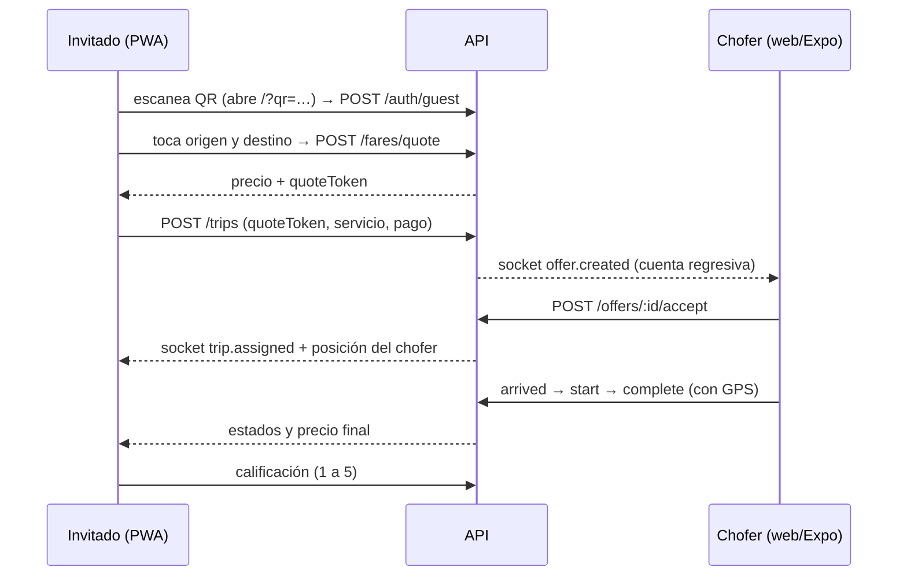
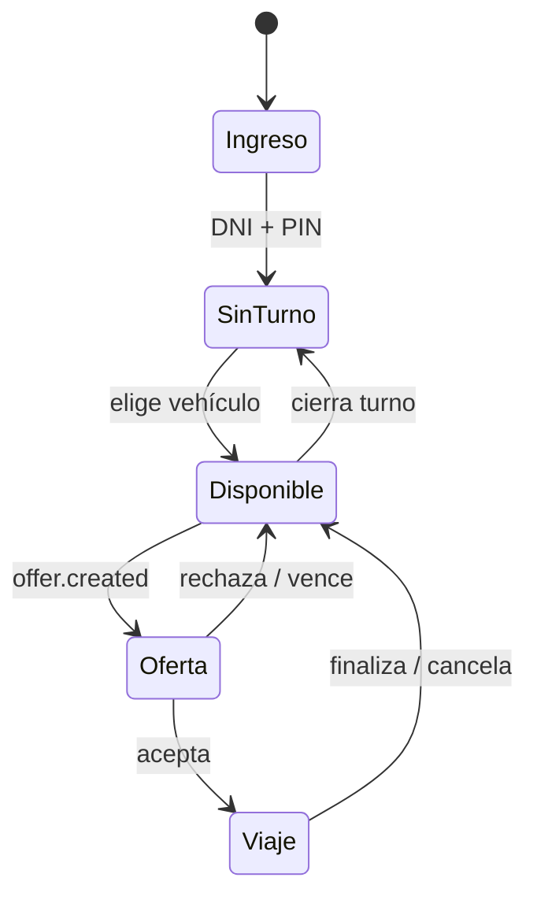

# Plan: Fase 4, app del chofer (web y Expo) y Modo Invitado por QR

> Planeación original (2026-11-22). Estado: **propuesta**, pendiente de aprobación.

Parte de los prototipos de kyan (`apps/driver-web`, `apps/driver-mobile`, `apps/guest-pwa`), que funcionan de punta a punta pero son pantallas mínimas.

**Problemas del chofer** (`driver-web` y `driver-mobile`):
- El vehículo se elige escribiendo su UUID.
- La posición es fija: no usa el GPS.
- La oferta se consulta cada 3 s, sin WebSocket.
- El viaje activo se recuerda en `localStorage` y no se recupera de la API.
- La sesión vence a los 15 min sin aviso.
- Los estados se muestran en inglés.
- En `driver-web` no existen las clases `.card`, `.btn` ni `.in`, así que la app se ve sin estilos.

**Problemas del invitado** (`guest-pwa`):
- El origen y el destino son el centro de la localidad.
- No se manda el `quoteToken`: el precio cotizado no queda garantizado.
- Solo hay servicio Taxi y pago en efectivo.
- El seguimiento consulta cada 3 s y no muestra al chofer.
- El pánico manda una ubicación fija.
- El QR escaneado con la cámara del teléfono no abre la PWA con el código.

## Decisiones tomadas

| Tema | Decisión |
|---|---|
| App del chofer | **Las dos** (elegido por el usuario el 2026-11-22). Primero `driver-web` como PWA instalable; después `driver-mobile` (Expo) con las mismas pantallas. |
| Lógica compartida | Nuevo paquete `packages/driver-core`: TypeScript puro, sin React, DOM ni React Native. Incluye cliente de la API con renovación del token, máquina de estados del turno y del viaje, textos en español y formato de importes. Lo usan las dos apps del chofer, así la versión Expo no duplica reglas. |
| Ubicación del invitado | **Mapa + mi ubicación** (elegido por el usuario el 2026-11-22). Leaflet con teselas de OpenStreetMap, como el panel. El origen se toma del GPS o tocando el mapa y el destino, tocando el mapa. La localidad y el alcance (urbano o interurbano) los resuelve la API al cotizar. |
| Tiempo real | Socket.IO, ya disponible en la API: `/driver` para ofertas y cancelaciones, `/passenger` para estados y posición del chofer. Si el socket cae, se consulta por HTTP como respaldo y se piden los eventos perdidos (`resume` con `afterSeq`). |
| Precio | El invitado confirma con el `quoteToken` de la cotización. El precio final siempre lo calcula la API; el chofer ya no carga el taxímetro a mano (la API lo ignora). |
| GPS del chofer | En la web: `navigator.geolocation.watchPosition`, enviado en lotes cada 5 s a `POST /drivers/me/positions`. Para probar en la computadora hay un **modo simulado**, solo en desarrollo, que mueve el auto entre dos puntos. En Expo: `expo-location` en primer plano. El GPS en segundo plano queda para la Fase 6. |
| Navegación | Botón "Cómo llegar" que abre Google Maps o Waze con el destino. No se integra un navegador propio. |
| Mapa en Expo | Sin mapa nativo, para no sumar `react-native-maps`. Muestra direcciones y el botón "Cómo llegar". |
| Herramientas de prueba | "Crear viaje de prueba" queda solo con `NEXT_PUBLIC_DEV_TOOLS=true` (desarrollo). |
| Dependencias | Solo versiones que ya están en el lockfile (`leaflet`, `react-leaflet`, `socket.io-client`) y las de Expo que ya usa `driver-mobile`. Nada nuevo para instalar en la máquina. |
| `passenger-mobile` | No se toca (trabajo sin commit de kyan). |

## 1. El flujo completo

## 2. API (cambios chicos)

- `GET /drivers/me/vehicles`: los vehículos con los que el chofer puede iniciar turno (sale de `v_driver_vehicle_eligibility`), con patente, servicio, si es elegible y el motivo del bloqueo.
- `GET /drivers/me`: nombre, agencia, localidad base y vencimientos, para el encabezado de la app.
- Tests de integración de los dos endpoints. Sin migraciones.

## 3. `packages/driver-core`

- `api.ts`: cliente con `fetch` inyectable, renovación automática con `POST /auth/refresh` y errores legibles (401, 403, 409, 422).
- `shift.ts`: estados del turno (sin turno, disponible, con oferta, en viaje) a partir de `GET /drivers/me/state`.
- `trip.ts`: qué acciones corresponden a cada estado del viaje (Llegué, Iniciar, Finalizar, Cancelar, No se presentó, con la espera mínima) y textos en español.
- `pings.ts`: buffer de posiciones con lotes de hasta N puntos y reintento.
- `format.ts`: pesos, distancias y tiempos.
- Tests unitarios con Jest (como `packages/domain`).

## 4. `driver-web` (PWA)

- **Ingreso:** DNI y PIN con teclado numérico, mensajes claros (PIN bloqueado, habilitación vencida).
- **Turno:** lista de vehículos por patente; los no elegibles se muestran con el motivo. Indicador de GPS (precisión, último envío) y de conexión. Al recargar la página se recupera el estado desde la API.
- **Oferta:** tarjeta de pantalla completa con cuenta regresiva, distancia y tiempo hasta el pasajero, origen y destino, precio, "Viaje de Vuelta" si aplica, y vibración y sonido al llegar.
- **Viaje:** mapa con el auto, el origen y el destino; botón "Cómo llegar"; acciones según el estado; espera para "No se presentó"; precio final de la API; cobro en efectivo o estado del pago de Mercado Pago.
- **Pánico:** botón fijo, con confirmación de 2 s (mantener apretado), ubicación real y `clientEventId` para que un reintento no duplique la alerta.
- `manifest.json`, íconos y `theme-color` para instalarla en Android.

## 5. `driver-mobile` (Expo)

- Las mismas pantallas, con `driver-core`.
- `expo-location` para el GPS y `socket.io-client` para las ofertas.
- `AsyncStorage` para la sesión.
- Se verifica con `typecheck` y con la exportación web de Expo (`react-native-web`, ya en las dependencias). Probarla en un teléfono con Expo Go queda a cargo del usuario.

## 6. `guest-pwa` (Modo Invitado)

- **Entrada:** el QR impreso abre `/?qr=<código>` y el código se toma de la URL. Escanear con la cámara dentro de la PWA y escribir el código a mano siguen como alternativas.
- **Pedido:** mapa centrado en la ubicación del QR o del GPS; "Usar mi ubicación"; tocar para fijar el destino; dirección opcional; Taxi o Remis; efectivo o Mercado Pago.
- **Cotización:** precio cerrado con detalle (bandera, fichas, retorno), temporada y franja en español, y cuenta regresiva de validez. Si vence, se recotiza sin volver atrás.
- **Seguimiento:** línea de tiempo (Buscando chofer, Asignado, En camino, Llegó, En viaje, Finalizado); el auto en el mapa; patente, modelo, color y nombre del chofer; cancelar mientras busca o antes de que llegue; "No hay choferes" con opción de reintentar.
- **Al terminar:** precio final, pago con Mercado Pago (proveedor falso en desarrollo) y calificación.
- **Pánico:** el mismo patrón que el chofer, con la ubicación del teléfono.
- **Resiliencia:** service worker propio que cachea el shell de la app; reintentos con espera creciente; el viaje en curso se recupera al recargar.

## 7. Estilo común

Los mismos colores y componentes del panel (`.card`, `.btn`, `.in`, etiquetas de estado), adaptados a teléfono: botones de 48 px o más, texto de 16 px y contraste AA. Se prueba a 375 px de ancho.

## 8. Requisitos antes de empezar

- Ninguno para desarrollo. Para el QR firmado en producción ya existe `POST /auth/guest-qr-codes`; en desarrollo se usa `ALLOW_UNSIGNED_QR=true`.
- Para probar en un teléfono real: la API y las apps tienen que ser accesibles desde la red local (IP de la PC en lugar de `localhost`) y el GPS del navegador exige HTTPS fuera de `localhost`. Se documenta cómo hacerlo, no se configura.

## 9. Orden de implementación

1. API: `GET /drivers/me/vehicles` y `GET /drivers/me`, con tests.
2. `packages/driver-core`, con tests.
3. `driver-web`: estilos, ingreso, turno, oferta por socket, viaje con mapa y GPS, pánico, PWA.
4. `guest-pwa`: QR por URL, mapa, cotización con token, seguimiento por socket, pago y calificación, service worker.
5. Prueba de punta a punta en el navegador: un invitado pide, el chofer acepta y completa, y el invitado califica.
6. `driver-mobile` con `driver-core`: typecheck y exportación web.
7. `DOCUMENTACION.md`, `GUIA_IMPLEMENTACION.md`, fila en la bitácora, `PENDIENTES.md` y README.
