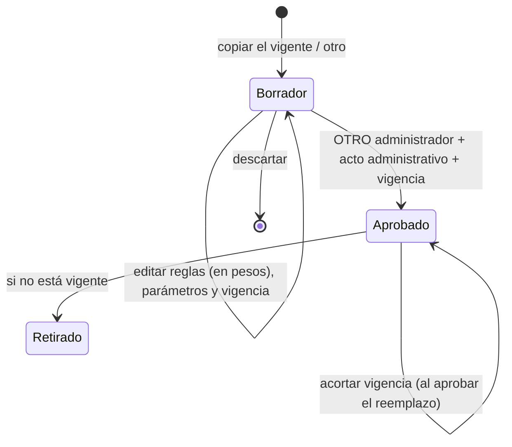
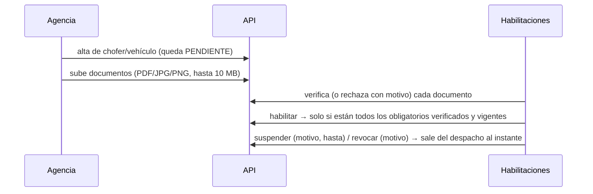

# Documentación: Fase 5, panel administrativo

El panel municipal (`apps/admin-web`) pasó de ser de consulta a ser administrativo. Ahora tiene:

- usuarios con roles y permisos, y segundo factor;
- tarifas configurables con doble control;
- parámetros editables;
- habilitaciones con documentos y verificación;
- auditoría de todo lo anterior.

La API es la que decide los permisos; el panel solo oculta lo que el rol no puede usar.

```mermaid
flowchart LR
  U[Usuario del panel] -->|usuario + contraseña| L[POST /auth/operator/login]
  L -->|tiene 2FA| M[POST /auth/operator/mfa]
  L -->|sin 2FA| S
  M --> S[Sesión: token 15 min + refresh rotativo]
  S --> G{AuthGuard en cada pedido}
  G -->|rol y estado leídos de la base| P{@RequirePermission}
  P -->|ok| E[Endpoint]
  E --> A[(audit_log, misma transacción)]
```

## Roles y permisos

Están definidos en `packages/domain/src/permissions.ts`, que es la fuente única para la API y el panel. Los roles son fijos: cambiarlos es un cambio de código.

| Rol | Para qué | Segundo factor |
|---|---|---|
| Administrador (`MUNICIPAL_ADMIN`) | Todo, salvo atender alertas del COM: usuarios, configuración, tarifas, vouchers, habilitaciones y auditoría | Obligatorio |
| Habilitaciones (`LICENSING_OFFICER`) | Alta y edición de flota, documentos, verificación, habilitar, suspender, revocar y reseteo de PIN | Obligatorio |
| Operador COM (`COM_OPERATOR`) | Monitoreo, alertas de pánico (atender y resolver) y viajes (ver y cancelar) | Opcional |
| Auditor (`AUDITOR`) | Solo lectura de todo, más la auditoría; datos personales enmascarados | Opcional |
| Operador de agencia (`AGENCY_OPERATOR`) | Carga choferes, vehículos y documentos de **su** agencia; queda todo pendiente hasta que lo verifica Habilitaciones | Opcional |

La matriz completa se ve en **Roles y permisos** del panel (`GET /admin/roles`).

- **Cómo se exige:** `@RequirePermission('permiso')` solo se aplica a operadores; pasajeros y choferes siguen con `@Allow`. Los endpoints anteriores se pasaron de `@Allow('MUNICIPAL_ADMIN')` a permisos.
- **Datos personales:** DNI y teléfono completos solo con `personal_data.view`; sin ese permiso la API los manda enmascarados (`28.***.789`).
- **Alcance de la agencia:** la agencia siempre trabaja con su `agency_id`, aunque mande otro, y solo edita lo que está pendiente. Lo habilitado lo modifica Habilitaciones.

## Sesiones, contraseñas y segundo factor

- **El rol se lee de la base, no del token.** `OperatorStateService` tiene caché de 15 s, así que un cambio de rol o una baja tienen efecto en segundos, sin esperar a que venza el token.
- **Revocación:** `sessions_revoked_at` invalida todos los tokens emitidos antes. Los tokens llevan `iatMs`, la emisión en milisegundos, porque `iat` en segundos no alcanza para distinguir un token emitido justo antes de uno emitido justo después. También se revocan los refresh tokens.
- **Configuración pendiente:** con contraseña temporal o con 2FA obligatorio sin activar, la sesión solo puede usar los endpoints `@AllowDuringSetup` (`/auth/me`, cambiar contraseña, configurar 2FA). El panel lleva al usuario a **Mi cuenta**.
- **Contraseñas:** 12 caracteres o más, con letras y números, sin el nombre de usuario y no comunes (`security/password-policy.ts`). Las temporales tienen 14 caracteres sin letras ambiguas y se muestran una sola vez.
- **Bloqueo:** se bloquea después de N intentos fallidos por M minutos, valores editables en Configuración. Un administrador puede desbloquear.
- **Segundo factor (TOTP):**
  - RFC 6238, compatible con Google y Microsoft Authenticator, implementado con `node:crypto`.
  - El secreto se guarda cifrado con AES-256-GCM y una clave derivada de `JWT_SECRET` con propósito propio.
  - Cada código sirve una sola vez: se recuerda el último paso usado.
  - Hay 10 códigos de recuperación de un solo uso (se guarda su hash) y un tope de 5 códigos incorrectos cada 5 minutos.
- **Gestión de usuarios** (`/admin/users`):
  - Alta con contraseña temporal, edición, desactivación con motivo, desbloqueo y reseteo de contraseña o de 2FA.
  - Nadie cambia su propio rol ni se desactiva a sí mismo.
  - Siempre queda al menos un Administrador activo, con bloqueo de filas contra bajas simultáneas.

## Configuración

La tabla `system_settings` guarda tipo, rango, unidad y descripción de cada parámetro. `SettingsService` la lee al arrancar y cada 30 s, y aplica los valores sobre el `AppConfig` compartido, así que el código existente ve el valor nuevo sin cambios.

- **Precedencia:** mientras un parámetro no se editó desde el panel (`updated_by` NULL) manda la variable de entorno. Así los despliegues y los tests que fijan variables no cambian de comportamiento.
- **Con efecto inmediato:** tiempo de oferta, ofertas por ronda, tope de búsqueda, ventana de penalización por rechazo, espera por "no se presentó", frecuencia de ubicación al pasajero y escalamiento de pánico. Los intentos y el bloqueo de login los lee directamente la autenticación.
- **"Sin efecto todavía":** conservación de datos y cargo por cancelación se guardan pero el sistema todavía no los usa, y el panel lo indica.
- **QR del Modo Invitado:** el panel genera la dirección firmada `https://<pwa>/?qr=…` para imprimir.

## Tarifas configurables



- **Edición:** las 16 reglas se reemplazan juntas (`PUT /admin/tariff-schedules/:id/rules`) con validaciones de mínima ≥ bandera, retorno solo interurbano y enteros positivos.
- **Simulador** (`POST /admin/tariffs/simulate`): cotiza el mismo viaje con el borrador y con el vigente y muestra la diferencia en %. Usa el motor de cotización real con la opción interna `scheduleId`.
- **Aprobación:** si se superpone con el vigente y se marca "cerrar el vigente", el vigente termina el día en que empieza el nuevo; es la única edición permitida sobre un aprobado y solo a futuro. No se puede retirar el cuadro vigente: primero se aprueba el reemplazo.
- **La base lo refuerza:**
  - CHECK de doble control y `EXCLUDE` de superposición.
  - Trigger que congela las reglas fuera de borrador.
  - Trigger que congela los cuadros aprobados.
- **Calendario de temporada alta** (`season_periods`): alta, edición y baja, sin superposiciones.
- Al cambiar algo se vacía la caché de tarifas de la réplica. Las demás réplicas lo ven al vencer su caché (60 s).

## Habilitaciones



- **Documentos obligatorios** (provisorio, a definir con el municipio):
  - Chofer: DNI, licencia profesional, habilitación municipal y antecedentes.
  - Vehículo: VTV, seguro de pasajeros y habilitación municipal.
  - Agencia: constancia de CUIT y habilitación.
- **Archivos:**
  - Se validan por sus primeros bytes, no por la extensión: un ejecutable con nombre `.pdf` se rechaza.
  - Se guardan con `IFileStorage`. Hoy es `LocalFileStorage`, en `DOCUMENT_STORAGE_DIR` o `~/.lacosta-viaja/documents`, fuera del repositorio.
  - En la base quedan la clave, el hash SHA-256, el tipo y el tamaño.
  - Al subir otra versión del mismo tipo, la anterior queda como historial (`superseded_by`).
  - La descarga es con sesión y permiso, con `no-store` y `nosniff`.
- **Autorización chofer↔vehículo:** alta como pendiente y habilitación por Habilitaciones.
- **Vencimientos:** un tablero con lo que vence en 0, 7, 15, 30 o 90 días por chofer, vehículo y agencia. Lo vencido ya bloquea solo, porque la elegibilidad se calcula con las fechas.
- **PIN temporal del chofer:** se muestra una vez y además desbloquea el PIN.
- **Pendiente:** el alta y la edición de **agencias** (solo se cambia su estado).

## Auditoría

Cada acción administrativa se registra en `audit_log`, en la **misma transacción** que el cambio. Se guarda el antes y el después, la IP y el user agent. `AuditService.scrub` quita cualquier campo con aspecto de secreto y la auditoría no guarda DNI ni CUIL completos. Se consulta en la pantalla **Auditoría** (`GET /admin/audit`), con filtros y paginado; es de solo lectura.

## Panel

- **Sesión:** `lib/api.ts` usa el `ApiClient` de `@lacosta/driver-core`, que renueva el token solo; antes había que volver a entrar cada 15 min. `lib/session.tsx` trae el perfil con permisos y hace las redirecciones.
- **Menú y pantallas:**
  - El menú se arma según los permisos y una ruta sin permiso muestra "No tenés acceso".
  - La Consola COM muestra los botones de acción solo al Operador COM.
  - Vouchers oculta los formularios a quien solo puede ver.
- **Pantallas nuevas:** Usuarios, Roles y permisos, Configuración, Habilitaciones, Auditoría y Mi cuenta. Tarifas se rehízo.
- **Acciones peligrosas:** piden confirmación con resumen y, cuando corresponde, motivo (`ConfirmAction`).
- **Logo:** el del Municipio de La Costa (`public/logo-la-costa.png`, tomado de `mockup/assets`) en el menú y en el login.
