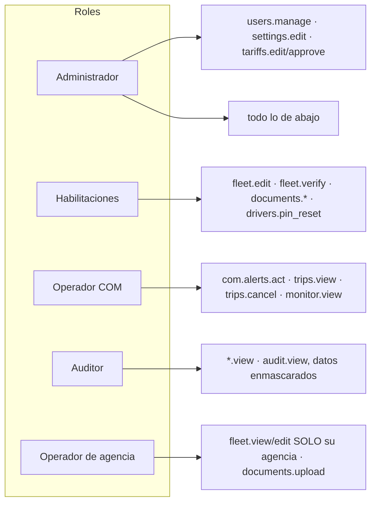
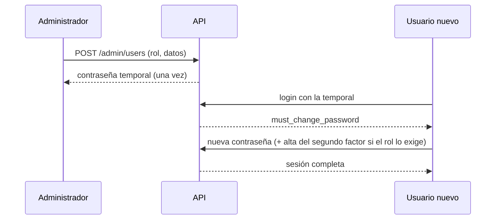
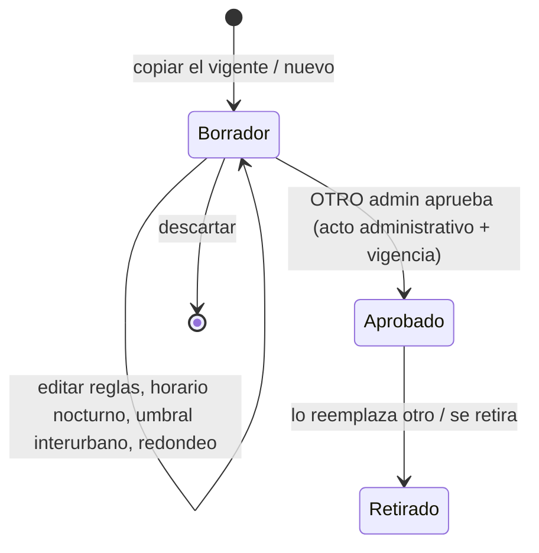
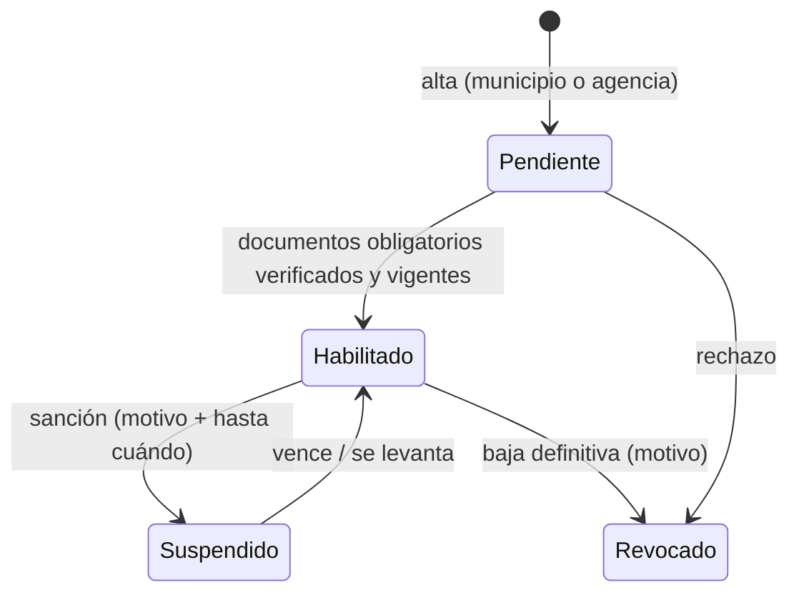

# Plan: Fase 5, panel administrativo (usuarios, roles, tarifas, configuración y habilitaciones)

> Planeación original (2026-11-22). Estado: **propuesta**, pendiente de aprobación.

Hoy el panel (`apps/admin-web`) es mayormente de consulta:

- **Usuarios:** no se pueden gestionar.
- **Roles:**
  - Hay 3 (`MUNICIPAL_ADMIN`, `COM_OPERATOR`, `AGENCY_OPERATOR`), controlados endpoint por endpoint con `@Allow`.
  - El panel muestra todo el menú a cualquiera y se entera del permiso recién cuando la API responde 403.
- **Tarifas:** el cuadro tarifario sale del seed y no se edita.
- **Parámetros:** los operativos (tiempo de oferta, espera por "no se presentó", escalamiento del pánico…) son variables de entorno.
- **Habilitaciones:** hay tablas para los documentos (`habilitation_documents`) y la auditoría (`audit_log`), pero ningún flujo que las use.

## Decisiones tomadas

| Tema | Decisión |
|---|---|
| Roles | **5 roles** (elegido por el usuario el 2026-11-22): Administrador, Habilitaciones, Operador COM, Auditor y Operador de agencia. Los roles son fijos y están en el código. |
| Permisos | Los roles se traducen a **permisos** (`users.manage`, `tariffs.approve`, `fleet.verify`, …) en `@lacosta/domain`, compartidos por la API y el panel. La API exige el permiso (`@RequirePermission`); el panel oculta lo que no corresponde, pero no es la barrera de seguridad. |
| Datos personales | DNI, CUIL, teléfono y domicilio completos solo para quien tiene `personal_data.view`. El resto los ve enmascarados (`28.***.789`). Lo aplica la API (Ley 25.326). |
| Tarifas | **Doble control** (elegido el 2026-11-22). Un administrador arma un borrador (copiando el vigente) y **otro** administrador lo aprueba, cargando el acto administrativo y la vigencia. Un cuadro aprobado no se edita. La superposición de vigencias ya la impide la base (`EXCLUDE`). |
| Segundo factor | **TOTP obligatorio** para Administrador y Habilitaciones, opcional para el resto (elegido el 2026-11-22). RFC 6238 con `node:crypto`, sin dependencias nuevas. El secreto se guarda cifrado. Hay códigos de recuperación de un solo uso. |
| Documentos | **Disco local** detrás de la interfaz `IFileStorage` (elegido el 2026-11-22). En la base quedan el hash, el tipo, el tamaño y quién los subió o verificó. Se aceptan PDF, JPG y PNG de hasta 10 MB. Pasar a S3 o al almacenamiento municipal queda para la Fase 6. |
| Configuración | Tabla `system_settings` con tipo, mínimo, máximo y unidad por clave, y caché de 30 s en la API. Las variables de entorno siguen para infraestructura y secretos; los parámetros de negocio pasan a la base, con el valor del entorno como respaldo. |
| Auditoría | Toda acción administrativa (usuarios, roles, tarifas, configuración, habilitaciones, documentos) se registra en `audit_log` con quién, qué cambió (antes y después), IP y user agent. No se edita ni se borra. |
| Sesiones | Si a un usuario le cambian el rol, lo desactivan o le resetean la contraseña, se revocan sus sesiones. El panel renueva el token solo (pendiente del 2026-11-22). |

## 1. Roles y permisos

| Permiso | Admin | Habilit. | COM | Auditor | Agencia |
|---|:-:|:-:|:-:|:-:|:-:|
| Ver monitoreo y estadísticas | ✔ | ✔ | ✔ | ✔ | — |
| Alertas COM: ver | ✔ | — | ✔ | ✔ | — |
| Alertas COM: atender y resolver | — | — | ✔ | — | — |
| Viajes: ver y cancelar | ✔ / ✔ | ✔ / — | ✔ / ✔ | ✔ / — | su agencia / — |
| Flota: ver | ✔ | ✔ | ✔ | ✔ | su agencia |
| Flota: alta y edición | ✔ | ✔ | — | — | su agencia (queda pendiente) |
| Documentos: subir | ✔ | ✔ | — | — | su agencia |
| Documentos: verificar o rechazar | ✔ | ✔ | — | — | — |
| Habilitar, suspender o revocar | ✔ | ✔ | — | — | — |
| Resetear el PIN de un chofer | ✔ | ✔ | — | — | — |
| Tarifas: ver | ✔ | ✔ | ✔ | ✔ | ✔ |
| Tarifas: borrador | ✔ | — | — | — | — |
| Tarifas: aprobar (otro admin) | ✔ | — | — | — | — |
| Vouchers y programas | ✔ | — | — | ver | — |
| Configuración: ver y editar | ✔ / ✔ | ver | ver | ver | — |
| Usuarios: gestionar | ✔ | — | — | — | — |
| Auditoría | ✔ | — | — | ✔ | — |
| Datos personales completos | ✔ | ✔ | ✔ (solo en alertas y viajes) | — | su agencia |

La matriz definitiva queda en `packages/domain/src/permissions.ts` y la pantalla "Roles" del panel la muestra (sin edición). Un test verifica que todo endpoint del panel tenga un permiso declarado.

## 2. Gestión de usuarios

- **Lista:** nombre, usuario, rol, agencia, estado (activo, bloqueado, inactivo), segundo factor y último ingreso.
- **Alta:**
  - Datos: nombre, usuario, correo, rol y agencia (obligatoria solo para el operador de agencia).
  - Se genera una **contraseña temporal** que se muestra una sola vez; en el primer ingreso hay que cambiarla.
- **Edición:** nombre, correo, rol y agencia. Cambiar el rol revoca las sesiones.
- **Acciones:** desactivar o reactivar, desbloquear, resetear la contraseña (con otra temporal) y resetear el segundo factor.
- **Reglas:**
  - No se puede desactivar ni bajar de rol al último administrador activo.
  - Nadie puede cambiar su propio rol.
  - Contraseña de 12 caracteres o más, distinta del usuario.
- **Mi cuenta:** cambiar la contraseña y activar o desactivar el segundo factor (si el rol lo permite).

## 3. Tarifas configurables

- Editor del borrador: una grilla por servicio, alcance, temporada y franja con bandera, ficha, metros y segundos por ficha, mínima, retorno y exención por Viaje de Vuelta, más los parámetros del cuadro.
  - Los importes se cargan en pesos.
  - Se valida lo mismo que en la base (mínima ≥ bandera; retorno solo interurbano).
- **Simulador:** el borrador se cotiza con dos puntos del mapa o con viajes de ejemplo, comparado contra el cuadro vigente ("este viaje pasa de $ 7.480 a $ 8.200, +9,6 %").
- **Calendario de temporadas** (`season_periods`): alta, edición y baja de períodos de temporada alta, con validación de superposición.
- **Endpoints:**
  - `POST /admin/tariff-schedules` (borrador), `PUT /admin/tariff-schedules/:id/rules`.
  - `POST /admin/tariff-schedules/:id/approve`, `POST /admin/tariff-schedules/:id/retire`.
  - `POST /admin/tariffs/simulate`.
- La caché de tarifas de la API se invalida al aprobar o retirar.

## 4. Configuración

Pantalla con los parámetros agrupados. Cada uno muestra su descripción, unidad, rango permitido, valor por defecto, quién lo cambió por última vez y cuándo.

| Grupo | Parámetros (hoy en `.env` o fijos en el código) |
|---|---|
| Despacho | Tiempo de oferta, ofertas por ronda, tope de búsqueda, pesos del ranking (Viaje de Vuelta, cola, penalización por rechazo) y ventana de rechazos. |
| Viajes | Espera por "no se presentó", cargo por cancelación (hoy 0) y frecuencia de ubicación al pasajero. |
| Seguridad | Escalamiento de pánico, intentos de PIN y de contraseña antes del bloqueo, duración del bloqueo y duración de la sesión. |
| Conservación de datos | Días de recorrido GPS, eventos, alertas y documentos rechazados (requiere definición del municipio). |
| Modo Invitado | Generar QR firmados con nombre y zona para imprimir (ya existe `POST /auth/guest-qr-codes`; se suma la pantalla). |

- Los cambios se registran en la auditoría y se aplican en 30 s o menos, sin reiniciar la API.
- Los valores fuera de rango se rechazan.

## 5. Habilitaciones y verificación

- **Alta y edición** de choferes, vehículos y agencias. Hoy el panel solo los lista.
- **Documentos por entidad** (DNI, licencia profesional, VTV, seguro de pasajeros, habilitación municipal, antecedentes, CUIT):
  - Se suben y quedan "pendientes de verificación".
  - Habilitaciones los **verifica** contra el original, o los **rechaza** con motivo.
  - Se ve el historial de versiones.
- **Habilitar** solo se permite si están todos los documentos obligatorios para ese tipo de entidad, verificados y con fechas vigentes. La API lo comprueba con la misma lógica de `v_driver_vehicle_eligibility`.
- **Suspender, levantar la suspensión y revocar** llevan motivo, y la suspensión, fecha de fin. Si el chofer está en turno, se lo saca del despacho al instante.
- **Vencimientos:**
  - Tablero de lo que vence en 7, 15 y 30 días y de lo ya vencido, por chofer, vehículo y agencia.
  - Lo vencido ya bloquea solo (la elegibilidad se calcula con las fechas).
- **Resetear el PIN** de un chofer: se genera un PIN temporal que se muestra una vez.
- **Operador de agencia:** carga choferes, vehículos y documentos de su agencia. Todo queda "pendiente" hasta que Habilitaciones lo verifica.
- La verificación contra RENAPER, VTV o aseguradoras sigue fuera de alcance (ya está en `PENDIENTES.md`).

## 6. Auditoría

Pantalla con filtros por usuario, acción, entidad y fechas, y detalle con el antes y el después. Solo la ven Administrador y Auditor, y es de solo lectura. Los ingresos fallidos, los bloqueos y los cambios de segundo factor también quedan registrados.

## 7. Base de datos (migraciones nuevas, sin editar las aplicadas)

- `operator_role`:
  - Se agregan `LICENSING_OFFICER` (Habilitaciones) y `AUDITOR`.
  - `MUNICIPAL_ADMIN` sigue siendo el Administrador.
- `operator_users`: se agregan `email`, `must_change_password`, `password_changed_at`, `totp_secret_enc`, `totp_enabled_at`, `recovery_codes_hash text[]`, `last_login_at`, `sessions_revoked_at` y `created_by`.
- `system_settings` (clave, valor jsonb, tipo, mínimo, máximo, unidad, descripción, `updated_by`, `updated_at`), con seed de valores por defecto.
- `tariff_schedules`: se agregan `created_by`, `submitted_at` y una restricción que impide que lo apruebe el mismo usuario que lo creó.
- `habilitation_documents`:
  - Se agregan `status` (pendiente, verificado, rechazado), `rejected_reason`, `expires_on`, `storage_key` y `superseded_by`.
  - Los índices nuevos son comunes; no hay columnas geométricas.
- Actualizar `docs/MODELO_DATOS.md`.

## 8. API

- Módulo `admin` con controladores de usuarios, configuración, tarifas, habilitaciones, documentos y auditoría.
- Guard de permisos sobre el guard global actual.
- Servicio `AuditService` usado por todos.
- Login de operador en dos pasos cuando hay segundo factor (`POST /auth/operator/login` → `mfaToken` → `POST /auth/operator/mfa`). Cambio de contraseña obligatorio.
- Tests de integración: matriz de permisos (cada rol contra cada endpoint), doble control de tarifas, último administrador, revocación de sesiones, TOTP, habilitar sin documentos (rechazado) y auditoría de cada acción.

## 9. Panel (`apps/admin-web`)

- **Navegación:** el menú se arma según los permisos del usuario y las rutas sin permiso muestran "No tenés acceso". El encabezado indica el usuario, el rol y "Mi cuenta".
- **Sesión:** la renueva sola con el refresh token. Hay pantallas de segundo factor y de cambio de contraseña obligatorio.
- **Pantallas nuevas:** Usuarios, Roles (matriz de solo lectura), Configuración, Tarifas (vigente, borradores, editor, simulador, aprobación, calendario), Habilitaciones (alta y edición, documentos, verificación, estados, vencimientos), Auditoría y Mi cuenta.
- Las acciones peligrosas (suspender, revocar, aprobar una tarifa, desactivar un usuario) piden confirmación con resumen, y el motivo cuando corresponde.
- Mismo estilo que las tablas del 2026-11-22.

## 10. Requisitos antes de empezar

- Ninguno para desarrollo.
- **Definir con el municipio:**
  - Qué documentos son obligatorios por tipo (chofer, vehículo, agencia).
  - Plazos de conservación.
  - Si el Operador COM puede cancelar viajes.
  - Quiénes serán los administradores iniciales.
- Se usa el usuario demo `muni_admin` como primer administrador en desarrollo. Al hacerse obligatorio el segundo factor, va a pedir configurarlo en el primer ingreso.

## 11. Orden de implementación

1. Migraciones (roles, usuarios, configuración, tarifas, documentos) y `docs/MODELO_DATOS.md`.
2. Permisos en `@lacosta/domain` y guard en la API. Pasar los endpoints actuales de `@Allow` a permisos y enmascarar los datos personales.
3. Usuarios, contraseñas, segundo factor, revocación de sesiones y auditoría, con tests.
4. Configuración (`system_settings`) leída por despacho, viajes y pánico, con tests.
5. Tarifas: borrador, simulador, doble control y calendario, con tests.
6. Habilitaciones: alta y edición, documentos (almacenamiento local), verificación, estados y vencimientos, con tests.
7. Panel: sesión y segundo factor, navegación por permisos y las pantallas en el orden anterior.
8. Prueba en el navegador con cada rol.
9. `DOCUMENTACION.md`, `GUIA_IMPLEMENTACION.md`, bitácora y `PENDIENTES.md`.
