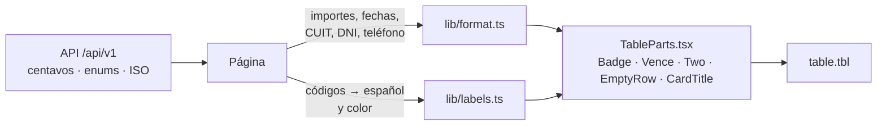
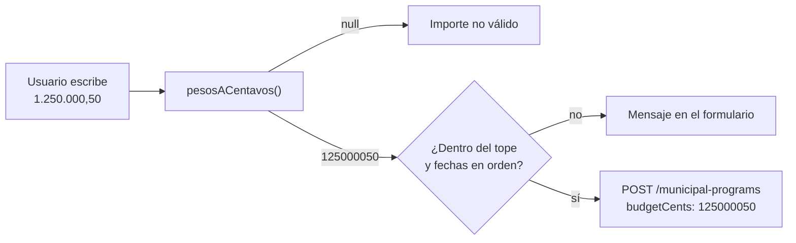

# Documentación: tablas legibles en el panel municipal

Las tablas del panel (`apps/admin-web`) muestran los datos de la API traducidos y con formato. La API sigue devolviendo centavos, códigos en inglés y fechas ISO. La traducción se hace solo al mostrarlos.

## Cómo se arma una tabla

| Pieza | Qué hace |
|---|---|
| `lib/format.ts` | `pesos(220000)` → `$ 2.200,00`; `fecha()` → AAAA-MM-DD en `America/Argentina/Buenos_Aires`; `fechaHora()`; `cuit()` → `30-70987654-2`; `dni()` → `33.444.555`; `telefono()`; `porcentaje(0.4)` → `40 %`; `vencimiento()` → vencido / por vencer (30 días o menos) / vigente. |
| `lib/labels.ts` | Diccionario de enums: servicio, alcance, temporada, franja, estado del cuadro, estado de habilitación y tipo de programa. Un código desconocido se muestra tal cual. También asigna el color de cada estado. |
| `components/TableParts.tsx` | `Badge` (etiqueta de color), `CodeBadge` (código traducido y coloreado), `Vence` (fecha en rojo si venció, en ámbar si vence pronto), `Two` (dato principal y secundario), `EmptyRow` y `CardTitle` (título con contador y ayuda). |
| `.tbl` en `globals.css` | Encabezado con fondo, bordes, filas alternadas, resaltado al pasar el mouse, números alineados a la derecha (`.num`) y filas de grupo (`.grp`). |
| `lib/api.ts` | Los errores se muestran en castellano: 401 "La sesión venció…", 403 "No tenés permiso… (requiere el rol …)". |

## Colores de estado

| Color | Estados |
|---|---|
| Verde | Aprobado, Habilitado, Activo |
| Ámbar | Borrador, Pendiente, Todavía no vigente, Temporada alta, Taxi |
| Rojo | Suspendido, Revocado, Vencido, PIN bloqueado |
| Azul | Temporada baja, Remis, tipo de programa |
| Gris | Retirado, Inactivo, Sin saldo |

## Pantallas

- **Cuadro Tarifario:** la tabla de cuadros muestra código, estado, vigencia (desde y hasta, exclusive), horario nocturno, instrumento legal (con la etiqueta "Ejemplo, no oficial" si empieza con "EJEMPLO") y paso de redondeo. Las reglas se separan en una tarjeta por servicio (Taxi, Remis) y se agrupan por alcance (Urbano, Interurbano), ordenadas por temporada y franja. Cada fila muestra bajada de bandera, ficha (valor y "cada X m o Y s de espera"), tarifa mínima y retorno (solo interurbano, con la aclaración si el Viaje de Vuelta lo exime).
- **Flota y Habilitaciones:**
  - Agencias: nombre comercial y razón social, CUIT, localidad y dirección, número de habilitación y vencimiento, estado.
  - Choferes: nombre y teléfono, DNI, agencia (o "Independiente"), base, habilitación municipal y licencia profesional con vencimientos, estado, PIN bloqueado y motivo de suspensión.
  - Vehículos: patente con forma de chapa, servicio, marca, modelo, año y color, plazas y accesibilidad, agencia, VTV, seguro de pasajeros y estado.
- **Vouchers y Beneficios:**
  - Programas: tipo, período, presupuesto, gastado, reservado y disponible, con una barra que se pone ámbar al 70 % y roja al 90 %.
  - Vouchers: código, nombre del programa, saldo sobre inicial, vigencia, nominativo o al portador, y estado (Activo, Vencido, Todavía no vigente, Sin saldo o Inactivo).

## Formularios de Vouchers

Los importes se escriben en pesos y la página los manda en centavos enteros, como pide la API.

- **Nuevo programa:** nombre, tipo, inicio y fin del período, presupuesto en pesos.
- **Nuevo voucher:** programa, código (opcional, lo genera la API), DNI del beneficiario (opcional, vacío = al portador), saldo inicial en pesos y vigencia. La vigencia se interpreta en hora de Buenos Aires.

## Lo que no cambió

- La API y la base de datos.
- Monitoreo, Estadísticas y la Consola COM, que no tienen tablas: usan tarjetas con datos de ejemplo.
