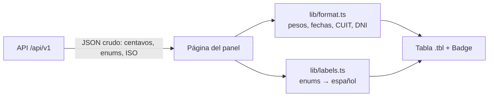

# Plan: tablas legibles en el panel municipal

> Planeación original (2026-11-22). Estado: **aprobado** (lo pidió el usuario en el chat el 2026-11-22).

El panel (`apps/admin-web`) muestra las tablas casi crudas: códigos en inglés (`TAXI`, `URBAN`, `LOW`, `NIGHT`, `APPROVED`), importes en centavos sin separador (`220000`), fechas en ISO, sin bordes ni separación entre columnas. La columna "Vigencia" de Cuadros tarifarios sale vacía porque la página lee `validity` y la API devuelve `valid_from` / `valid_to`.

## Decisiones tomadas

| Tema | Decisión |
|---|---|
| Alcance | Solo presentación en `apps/admin-web`. No cambia la API ni la base. |
| Importes | Se siguen guardando en centavos enteros; en pantalla se muestran en pesos (`$ 2.200,00`) con `Intl.NumberFormat('es-AR')`. |
| Fechas | Formato AAAA-MM-DD evaluado en `America/Argentina/Buenos_Aires`, como en el resto del proyecto. |
| Códigos | Un diccionario único (`lib/labels.ts`) traduce enums a español. Un código desconocido se muestra tal cual. |
| Estados | Etiquetas de color (`Badge`): verde activo/aprobado, ámbar pendiente/borrador, rojo suspendido/revocado/vencido, gris retirado/inactivo. |
| Vencimientos | Fecha en rojo si venció y en ámbar si vence en 30 días o menos. |
| Reglas tarifarias | Una tabla por servicio (Taxi, Remis), agrupada por alcance (Urbano, Interurbano), con columnas Temporada, Franja, Bajada de bandera, Ficha (con metros y segundos por ficha), Mínima y Retorno. |
| Estilo | Una clase `.tbl` en `globals.css` (encabezado con fondo, bordes, filas alternadas, números a la derecha con `tabular-nums`) y un componente de estado vacío. Sin dependencias nuevas. |

## 1. El flujo

## 2. Páginas que cambian

- **Cuadro Tarifario:** cuadros con estado, vigencia (desde/hasta), horario nocturno, instrumento legal y aviso si es un ejemplo de desarrollo; reglas agrupadas por servicio y alcance.
- **Flota y Habilitaciones:** agencias (nombre y razón social, CUIT con guiones, localidad, habilitación y vencimiento, estado), choferes (nombre y teléfono, DNI con puntos, agencia, base, habilitación municipal y vencimiento, estado), vehículos (patente, servicio, vehículo y año, plazas y accesibilidad, agencia, VTV y seguro, estado).
- **Vouchers y Beneficios:** programas (tipo, período, presupuesto, gastado, reservado, disponible con barra) y vouchers (código, programa por nombre, saldo sobre inicial, vigencia, estado).

## 3. Requisitos antes de empezar

Ninguno. Los datos del seed siguen siendo ilustrativos.

## 4. Orden de implementación

1. `lib/format.ts`, `lib/labels.ts`, componentes `Badge` y `EmptyRow`, clase `.tbl`.
2. Cuadro Tarifario.
3. Flota y Habilitaciones.
4. Vouchers y Beneficios.
5. Typecheck y verificación en el navegador.
6. `DOCUMENTACION.md`, `GUIA_IMPLEMENTACION.md`, fila en la bitácora y `PENDIENTES.md`.
